<!-- categoria assegnata per inferenza: verificare -->
<!-- procedura ricostruita dal video dimostrativo (immagini e voce dell'operatore) e confrontata con il manuale Q10A Rev. 2.00 -->

# Configurazione RT/POS

Procedura guidata, passo per passo, per configurare il registratore telematico **OMNI ONE** con il dispositivo POS **Q10A** (Custom Pay) e farli comunicare con il **protocollo 17**.

La procedura si svolge in tre fasi:

| Fase | Dove | Cosa si configura |
|------|------|-------------------|
| **1** | Registratore telematico (RT) | Parametri di rete dell'RT (menù **911 Ethernet**) |
| **2** | Registratore telematico (RT) | Comunicazione con il POS (menù **917 POS**), poi uscita dalla programmazione |
| **3** | POS Q10A | Rete del POS e collegamento all'RT (**PAX Tools**) |

!!! warning "Prima di iniziare"
    Per la comunicazione tra RT e POS occorre usare indirizzi IP **STATICI**, uno per il registratore di cassa e uno per il POS. Verificare che la rete locale del punto vendita sia attiva e che l'RT **Omni_One** siano collegati con cavo Ethernet.

## Valori usati nell'esempio

Gli indirizzi qui sotto sono quelli dell'esempio mostrato nelle immagini. Nell'installazione reale vanno sostituiti con i dati della rete del cliente.

| Parametro | Valore d'esempio |
|-----------|------------------|
| DHCP | Disabilitato |
| IP del registratore di cassa (RT) | `10.15.22.210` |
| Maschera subnet | `255.255.255.0` |
| Gateway | `10.15.22.254` |
| DNS | `10.15.22.254` |
| Porta protocollo (RT) | `9100` (valore di default, da lasciare) |
| IP del POS | `10.15.22.206` |
| Porta di comunicazione POS | `8080` |

---

## Fase 1 - Configurare la rete dell'RT (menù 911 Ethernet)

### 1. Accendere il registratore

Accendere l'OMNI ONE con il tasto di accensione posto sul **lato sinistro** del dispositivo: il display mostra l'assetto di registrazione (`0,00`).

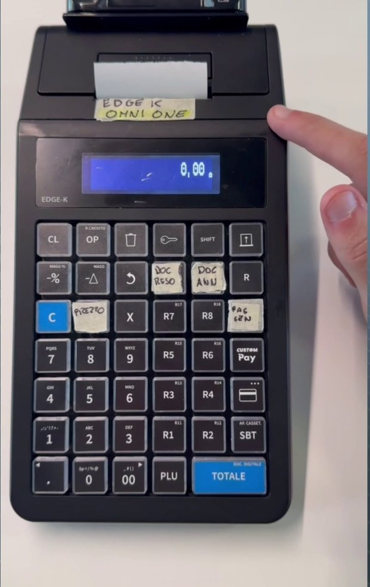

### 2. Entrare in assetto Programmazione

Premere il tasto **CHIAVE** per cambiare assetto operativo. Il display mostra in sequenza gli assetti (ad esempio **LETTURA**) fino ad arrivare a **PROGRAMMAZIONE**. In questo assetto si imposta con un **indirizzo IP statico** l'IP del registratore telematico.

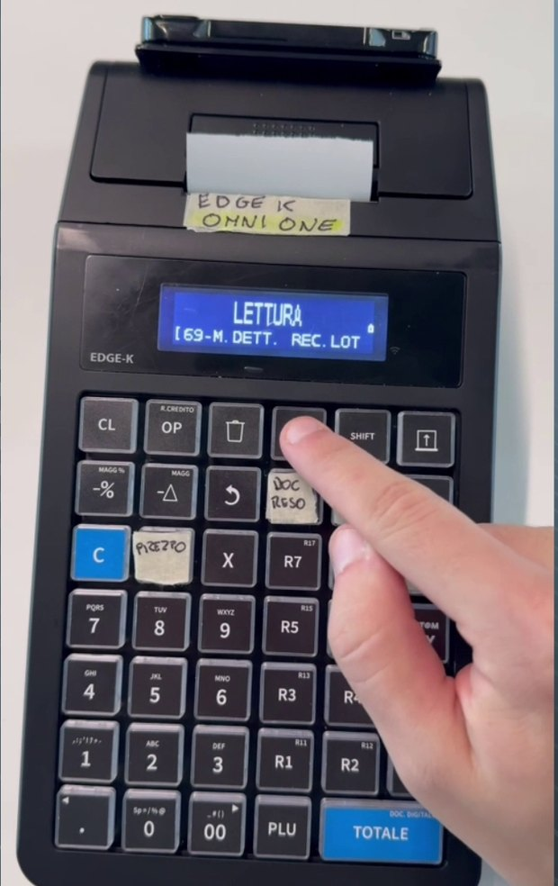

Il display mostra **PROGRAMMAZIONE** con la voce di menù.

### 3. Aprire il menù 911 e verificare il DHCP

Dal tastierino numerico digitare **911** e premere **SBT** (Subtotale) per entrare nel menù **[911-Ethernet]**.

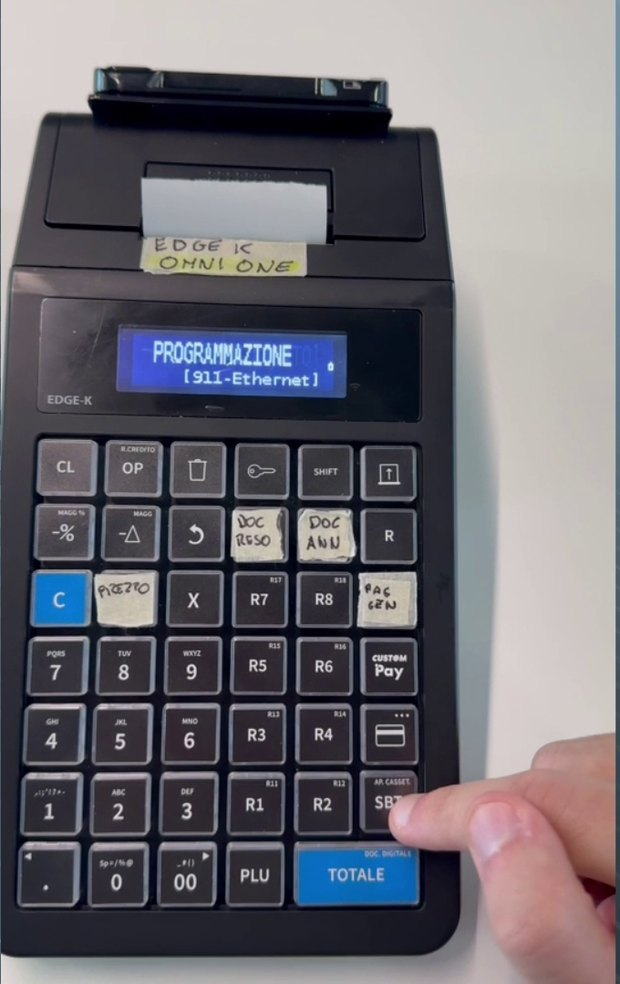

Il primo parametro è **ABILITA DHCP**: deve essere **[DISABILITATO]**.

![Display ABILITA DHCP [DISABILITATO]](assets/images/rt-pos-05-abilita-dhcp.jpg)

### 4. Indirizzo IP del registratore

Premere **SBT** per passare al parametro successivo. Alla voce **INDIRIZZO IP** impostare l'indirizzo IP statico del registratore telematico (es. `10.15.22.210`), scrivendolo dal tastierino numerico, e confermare con **SBT**.

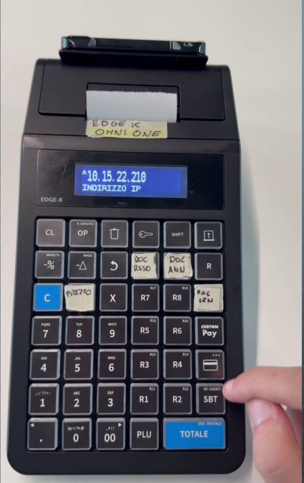

### 5. Maschera subnet

Alla voce **MASCHERA SUBNET** controllare o digitare la maschera di rete (es. `255.255.255.0`) e confermare con **SBT**.

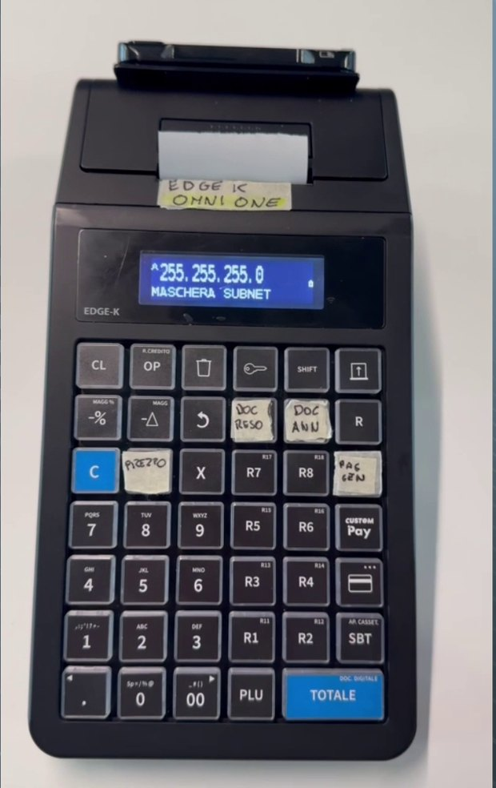

### 6. Gateway

Alla voce **GATEWAY** impostare il gateway della rete (es. `10.15.22.254`), sempre dal tastierino numerico, e confermare con **SBT**.

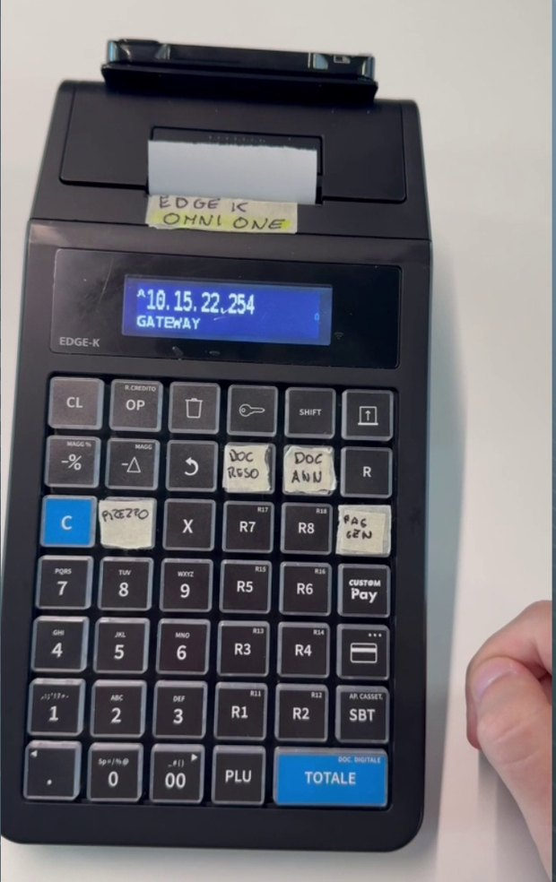

### 7. DNS

Alla voce **DNS** impostare l'indirizzo del DNS (es. `10.15.22.254`), dal tastierino numerico, e confermare con **SBT**.

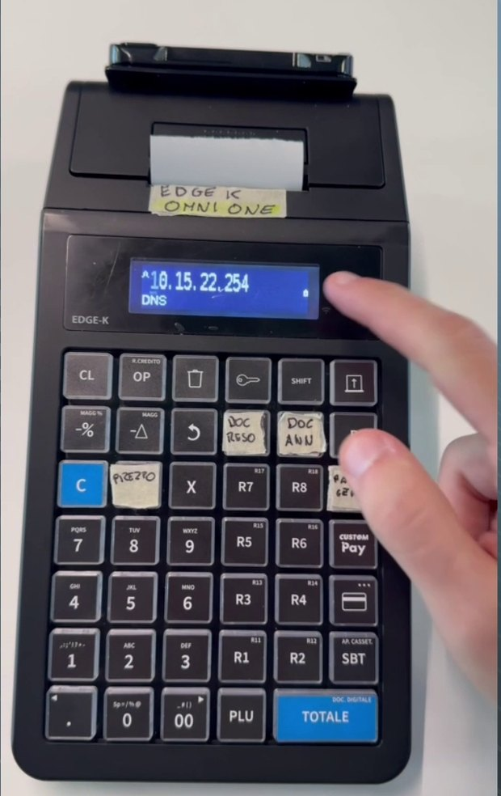

### 8. Porta protocollo

Alla voce **PORTA PROTOCOLLO** lasciare il valore di default (`9100`) e confermare con **SBT**.

### 9. MAC ID

Il **MAC ID** viene scritto in automatico: non c'è nulla da digitare. Premere **SBT** per concludere.

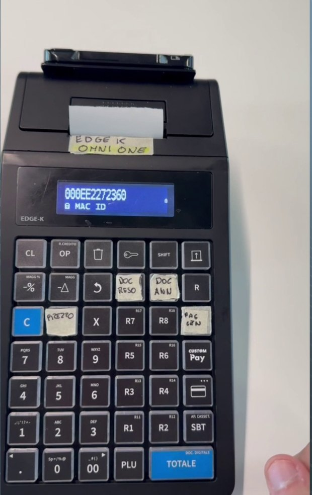

### 10. Controllare il documento gestionale

Al termine l'RT stampa un **documento gestionale** (resoconto) con i parametri di rete del registratore. Controllare che i valori corrispondano a quelli voluti.

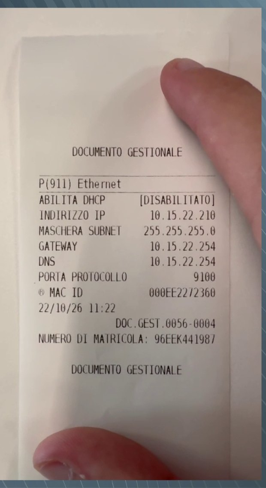

!!! note "Nota"
    Il documento riporta DHCP **[DISABILITATO]**, indirizzo IP, maschera subnet, gateway, DNS, porta protocollo e MAC ID. Conservare l'indirizzo IP dell'RT: servirà nella Fase 3.

---

## Fase 2 - Configurare la comunicazione con il POS (menù 917 POS)

### 11. Selezionare il menù 917 POS

Dopo la stampa il display torna su **PROGRAMMAZIONE**. Dal tastierino numerico digitare **917** e premere **SBT** per entrare nel menù **[917-POS]**.

![Display PROGRAMMAZIONE [917-POS]](assets/images/rt-pos-12-programmazione-917.jpg)

### 12. Abilitare la connessione Ethernet

La voce **CONNESSIONE ETH** deve essere **[ABILITATO]**. Se non lo è, premere il tasto **00** per spostarsi tra le due opzioni del menù (abilitato/disabilitato), quindi confermare con **SBT**.

![Display CONNESSIONE ETH [ABILITATO]](assets/images/rt-pos-13-connessione-eth.jpg)

### 13. Indirizzo IP del POS

Alla voce **INDIRIZZO IP** impostare l'indirizzo IP del **dispositivo POS** (es. `10.15.22.206`), scrivendolo dal tastierino numerico, e confermare con **SBT**.

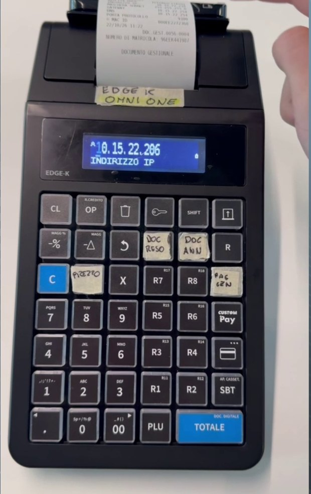

!!! warning "Attenzione"
    In questo menù l'indirizzo da inserire è quello del **POS**, non quello del registratore. È un IP **statico** che andrà configurato anche sul dispositivo POS nella Fase 3.

### 14. Porta di comunicazione

Alla voce **PORTA [1-65535]** digitare la porta di comunicazione (`8080`) e confermare con **SBT**.

![Display PORTA [1-65535] 8080](assets/images/rt-pos-15-porta-pos.jpg)

### 15. Scontrino su POS

La voce **SCONTRINO SU POS** deve essere **[DISABILITATO]**. Confermare con **SBT**.

![Display SCONTRINO SU POS [DISABILITATO]](assets/images/rt-pos-16-scontrino-su-pos.jpg)

### 16. Controllare il documento gestionale

L'RT stampa il documento **P(917) POS** con connessione ETH abilitata, indirizzo IP e porta del POS e scontrino su POS disabilitato. Verificare i valori: l'IP del POS servirà nella Fase 3.

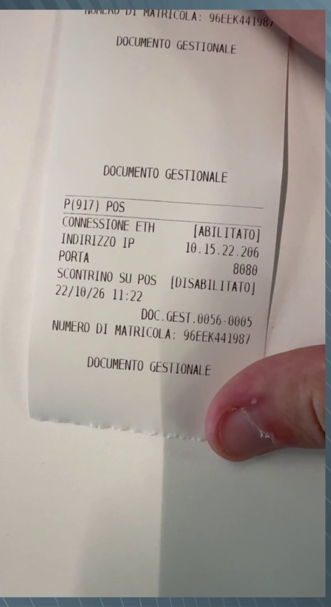

### 17. Uscire dalla programmazione

Premere due volte il tasto **CHIAVE** per uscire dalla programmazione e tornare in assetto di registrazione (display `0,00`).

---

## Fase 3 - Configurare il POS Q10A

### 18. Accedere al POS

Spostarsi sul dispositivo POS. Sul display compare la schermata iniziale di Custom Pay con l'importo `0,00`. Eseguire un **doppio tap nell'angolo in alto a sinistra** del display.

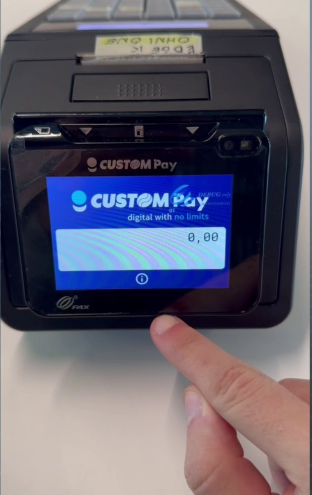

### 19. Inserire la password dinamica

Viene visualizzata la schermata **Inserisci la password**.

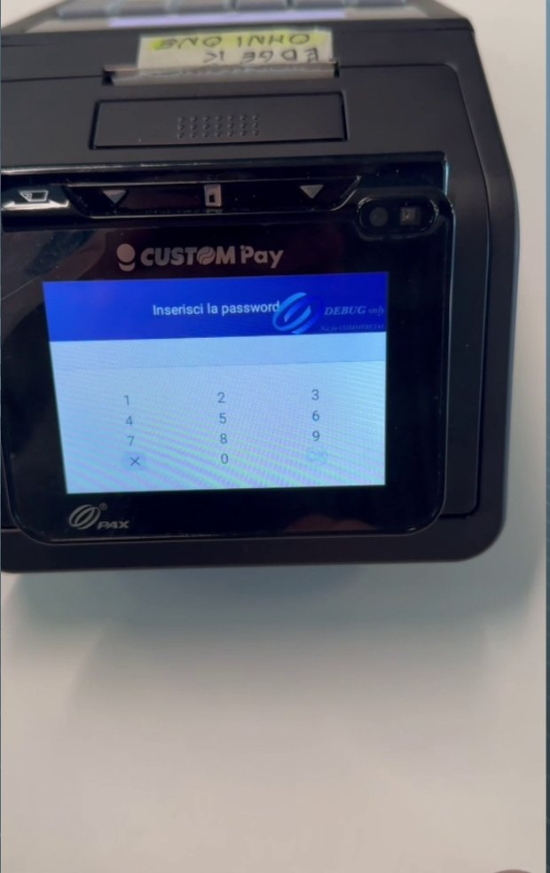

La password è **dinamica** e si compone nel formato `mm1gg7`: `mm` = mese corrente, `1`, `gg` = giorno odierno, `7`. Esempio: il 22 ottobre la password è `101227`. Digitarla con la tastiera numerica e confermare con **OK**.

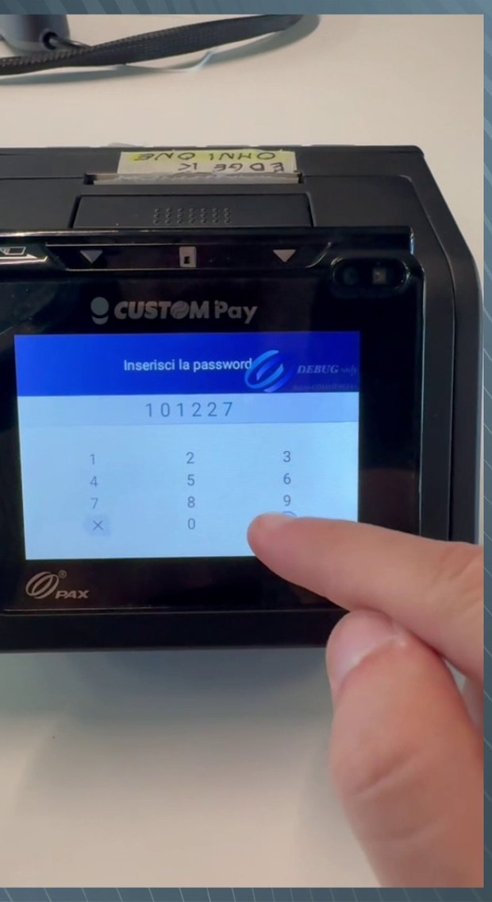

### 20. Impostare la rete Ethernet del POS

Aprire le **IMPOSTAZIONI**: qui la password è **fissa**, tramite tastiera numerica inserire la seguente password: **pax9876@@** 
(vedere il [paragrafo 2.3 del manuale](assets/resources/0576100M000218_2.00.pdf)). Selezionare **Rete e Internet**.

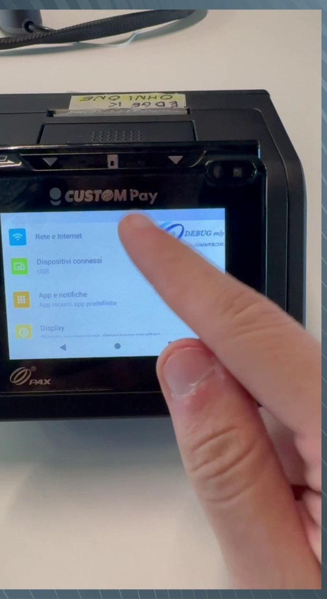

Selezionare la voce **Ethernet**: la modalità deve essere **Static IP**.

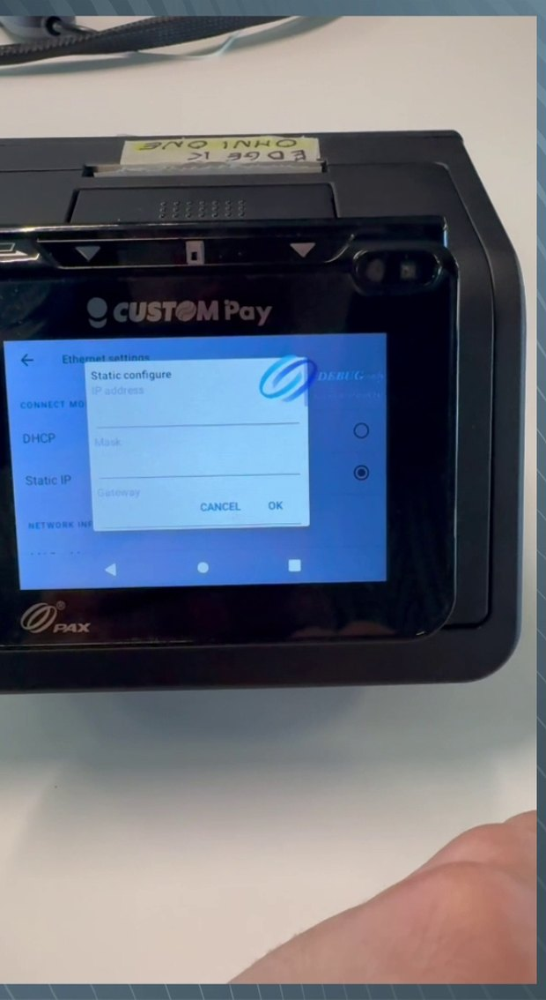

Nella finestra **Static configure** inserire l'indirizzo IP già impostato sulla parte fiscale nel menù **917** (nell'esempio `10.15.22.206`), insieme agli altri parametri di rete (maschera subnet, gateway, DNS), e confermare con **OK**.

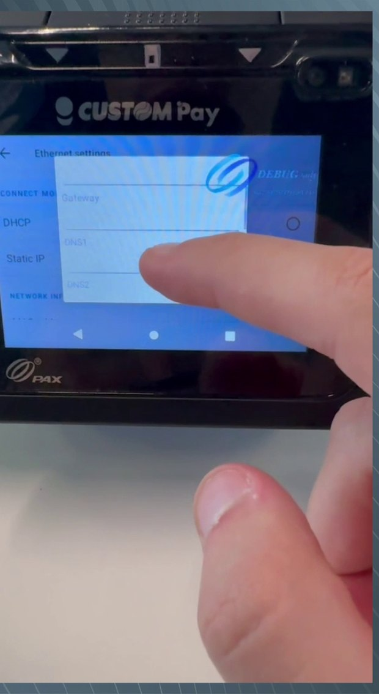

Se i parametri sono già stati impostati in precedenza, non serve ripetere l'operazione: nella schermata **Ethernet settings** si vedono i campi già compilati.

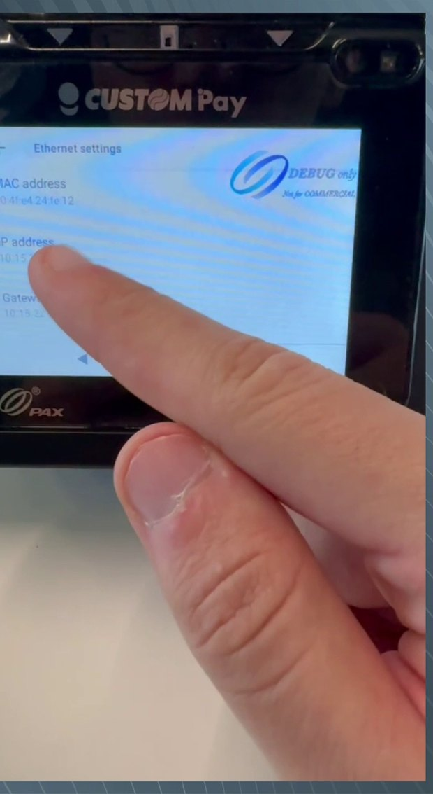

### 21. Aprire PAX Tools

Premere il **pulsante centrale (tondo)** per tornare al menù principale e aprire **Applicazioni**, poi **PAX Tools**.

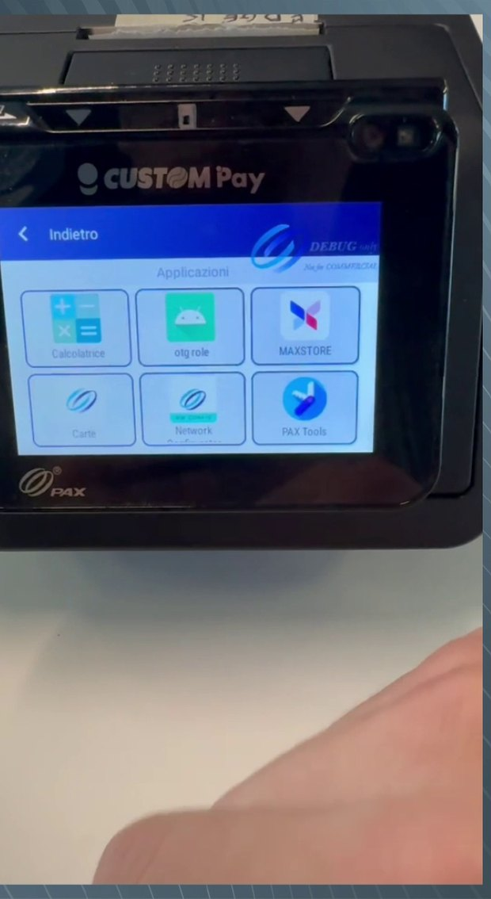

Inserire la **password installatore**, sempre uguale (vedere il [capitolo 5 del manuale](assets/resources/0576100M000218_2.00.pdf)), e confermare con **OK**.

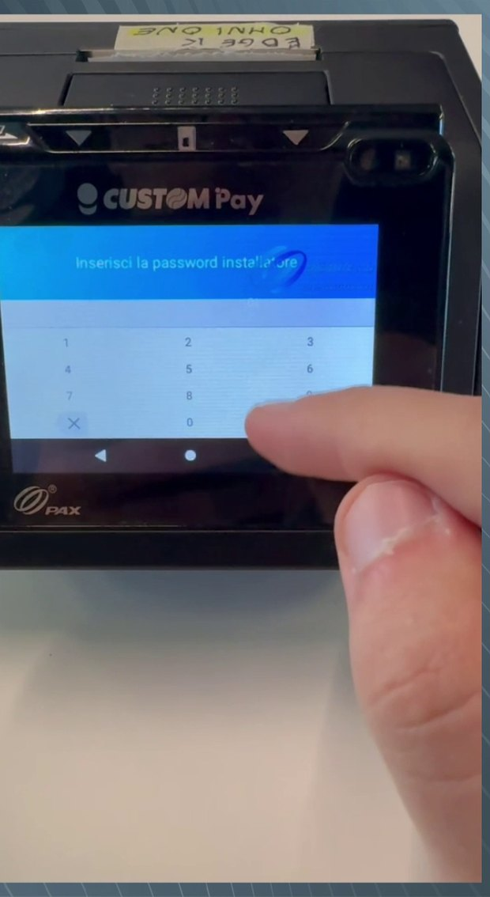

### 22. Configurare l'ECR (protocollo 17)

Premere **CONFIGURA ECR** e selezionare **ECR 17**. Sono presenti anche le **ALTRE OPZIONI**.

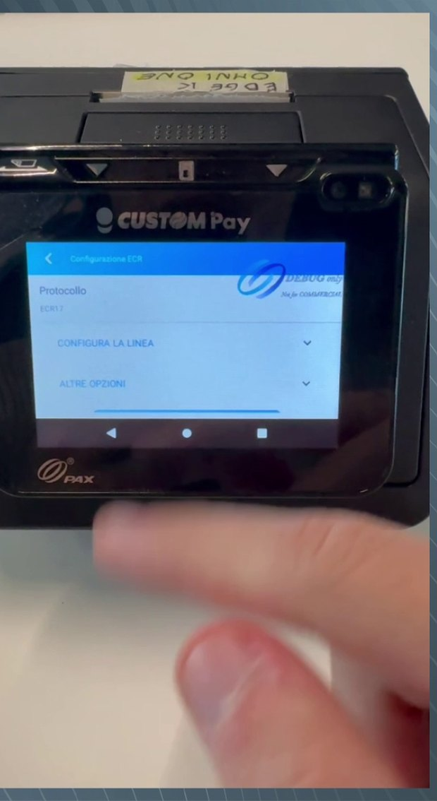

Aprire **CONFIGURA LA LINEA** e controllare i parametri:

- **Tipo di linea**: TCP
- **Porta terminale**: `8080`
- **IP terminale**: viene compilato automaticamente dal dispositivo POS

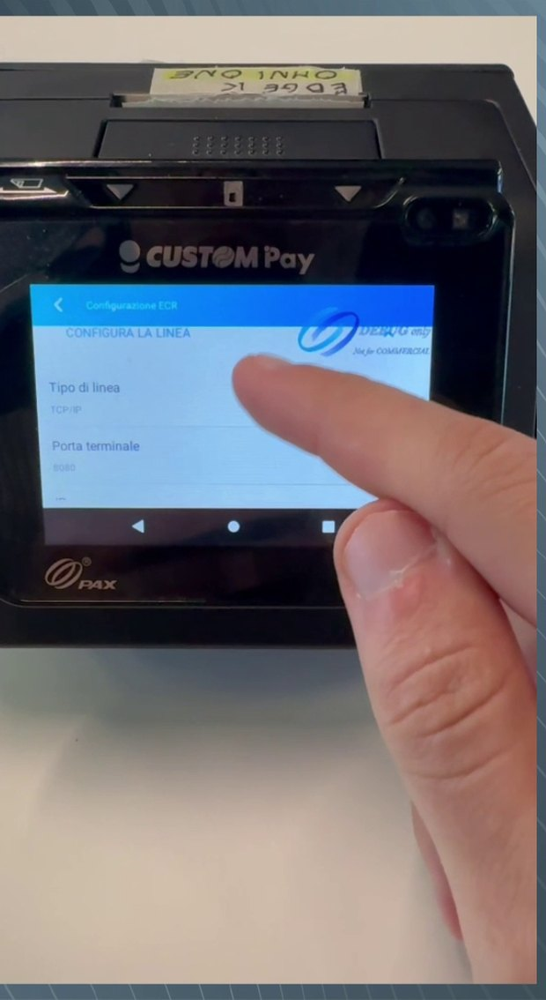

### 23. Inserire l'IP del registratore

Premere **IP cassa** e digitare l'indirizzo IP della **parte fiscale** impostato nel menù **911** (nell'esempio `10.15.22.210`). Confermare con **OK** (o **FINE**) e tornare indietro con il pulsante tondo.

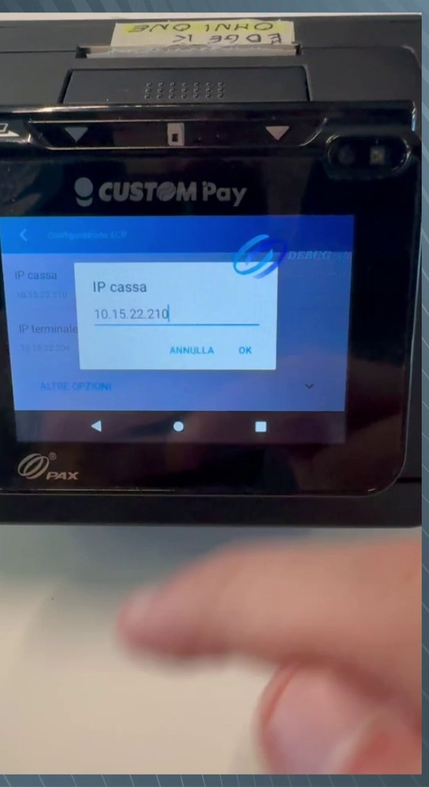

!!! tip "Dove trovare l'IP"
    L'indirizzo dell'RT è riportato nel documento gestionale **P(911) Ethernet** stampato nella Fase 1.

### 24. Verifica finale

Quando il display del POS mostra la stessa dicitura che appare sul display operatore del registratore (**OMNI ONE**), RT e POS sono configurati correttamente.

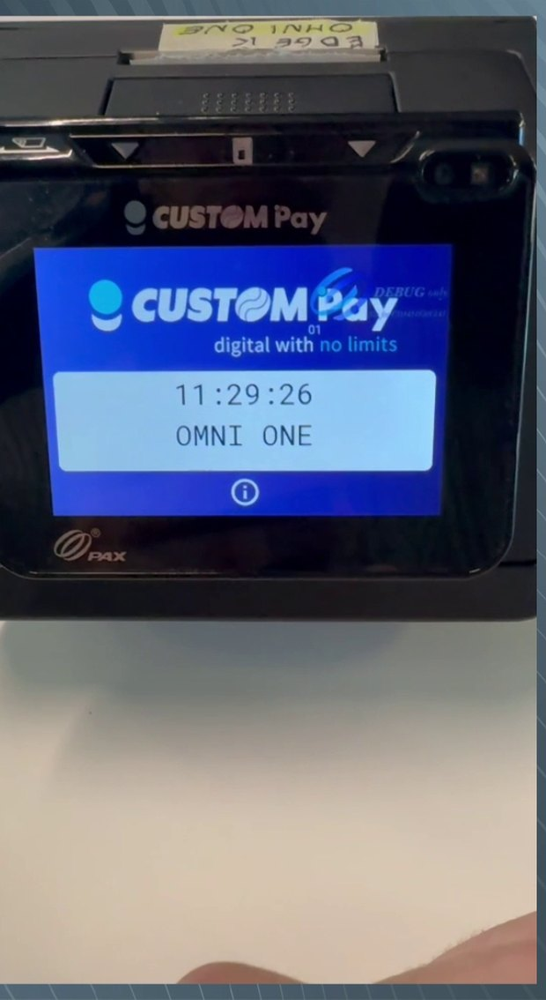

---

## Riepilogo dei collegamenti

| Dove | Parametro | Valore |
|------|-----------|--------|
| RT - menù 911 | Indirizzo IP | IP del **registratore** |
| RT - menù 917 | Indirizzo IP | IP del **POS** |
| POS - Static IP | IP address | IP del **POS** (lo stesso del menù 917) |
| POS - PAX Tools | IP cassa | IP del **registratore** (lo stesso del menù 911) |

## Approfondimenti

- [Configurazione carte](q10a-comunicazione-pos.md)
- [Manuale di configurazione Q10A (PDF)](assets/resources/0576100M000218_2.00.pdf)
