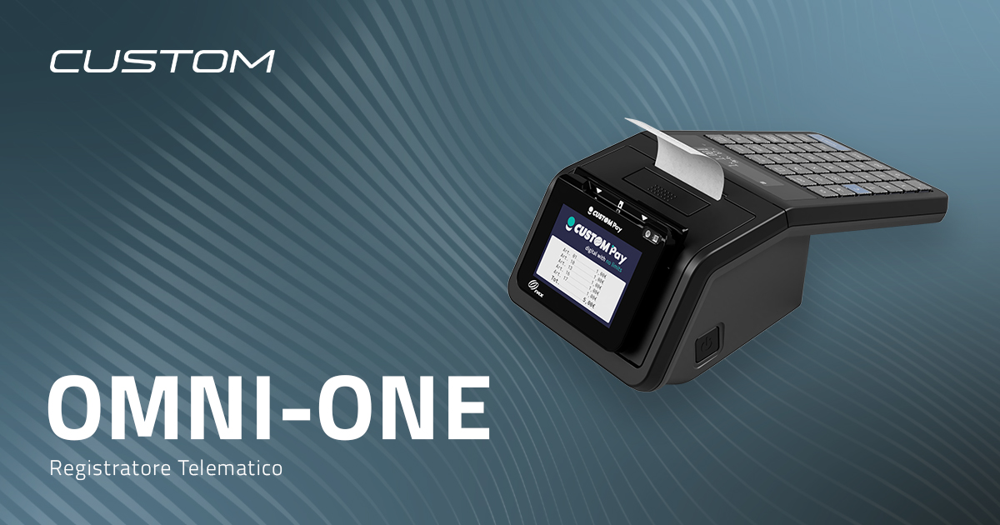
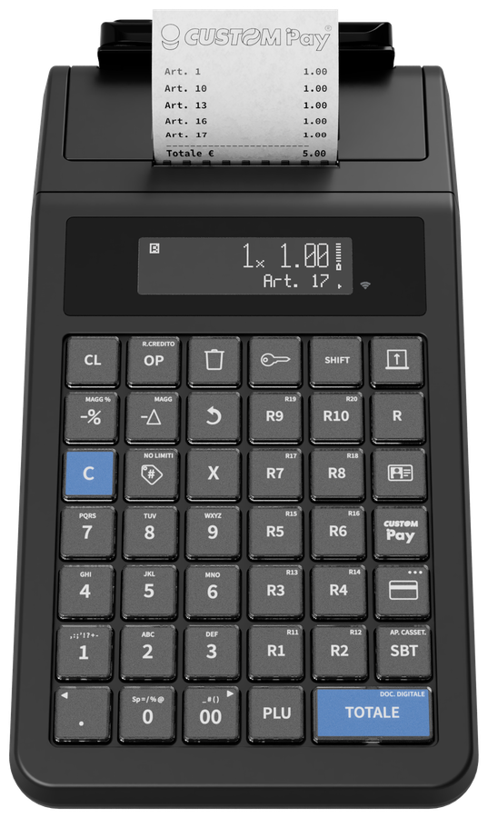
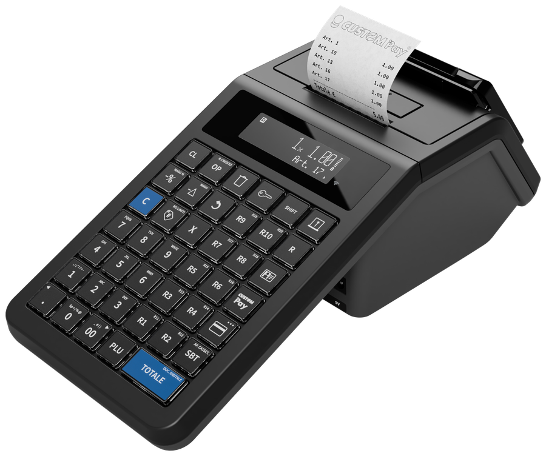
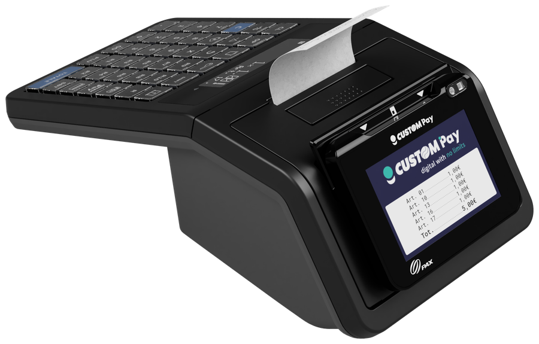
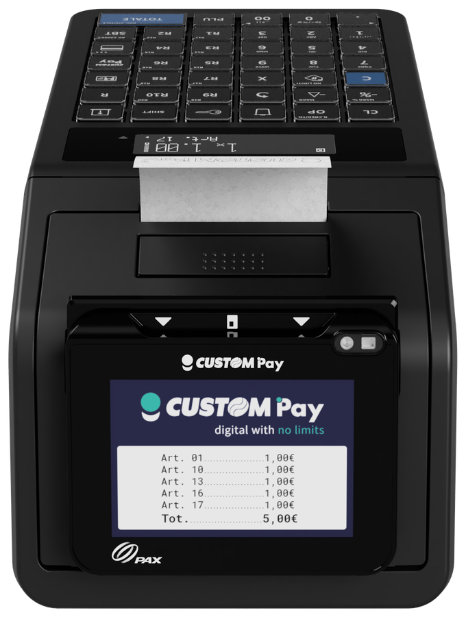
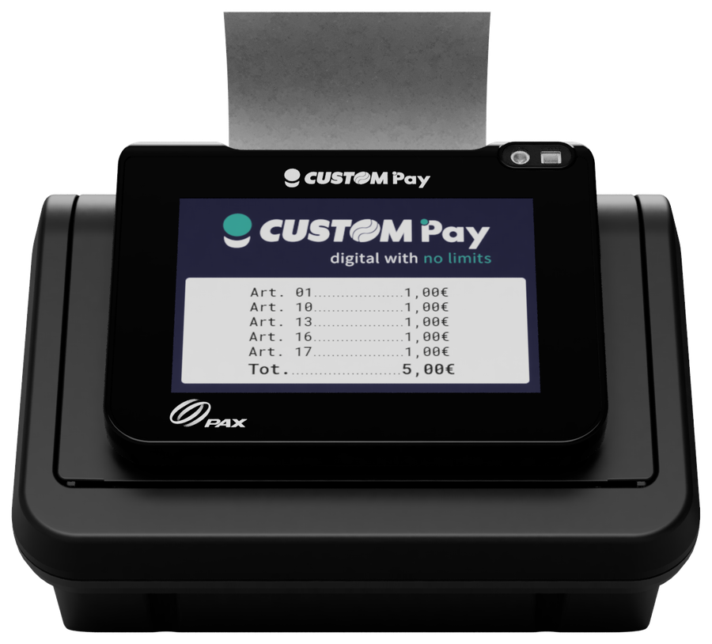
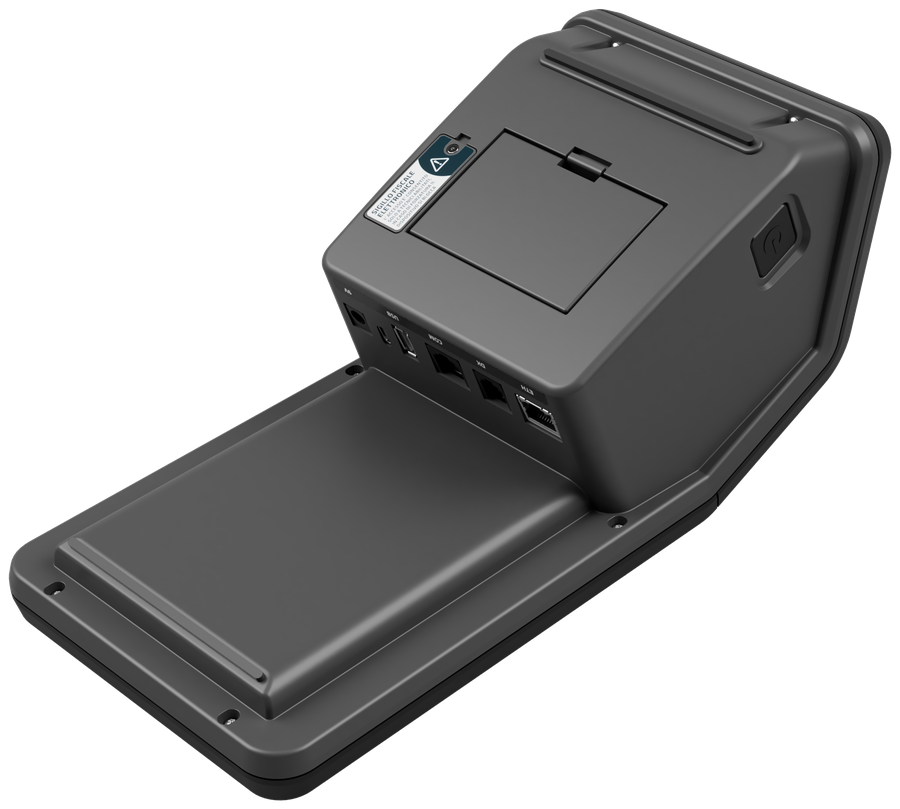
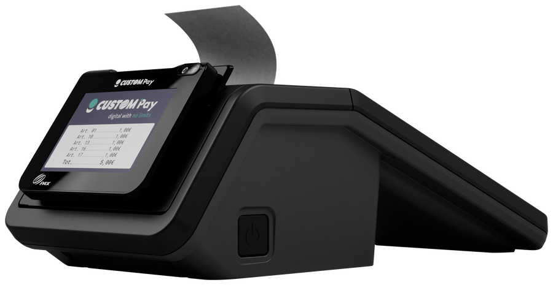
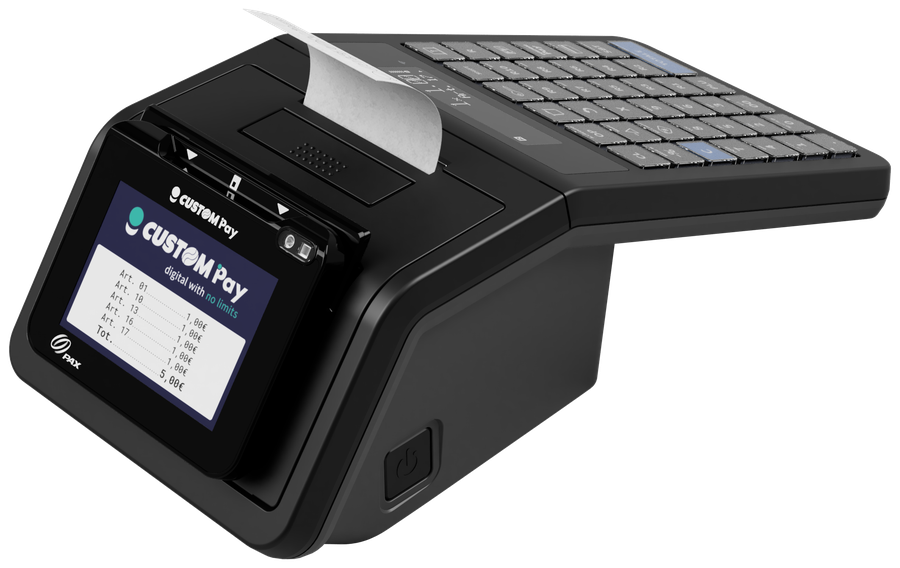

<!-- categoria assegnata per inferenza: verificare -->
<!-- specifiche tratte dalla scheda prodotto OMNI-ONE Rev. 1.00 09/2026, dal sito custom.biz e dalla guida introduttiva Rev. 1.10 -->

# OMNI-ONE

**Registratore telematico mobile con modulo di pagamento integrato**

OMNI-ONE è il registratore telematico affidabile, semplice da installare e facile da trasportare, pensato per gestire le operazioni di vendita e la trasmissione dei corrispettivi con continuità anche fuori dal negozio. Il modulo di pagamento integrato accetta transazioni **chip & PIN** e **contactless** direttamente dal dispositivo, **senza POS esterno**.

[Scarica la scheda prodotto (PDF)](assets/resources/OMNI-ONE-datasheet.pdf)

## Punti di forza

| | |
|---|---|
| **Mobilità quotidiana** | Pensato per vendite itineranti, mercati, fiere e attività fuori sede. Formato ultra-compatto, facile da trasportare, installare e integrare anche in spazi ridotti. |
| **Autonomia estesa** | Predisposizione per batteria esterna opzionale a lunga durata, ideale dove non c'è alimentazione fissa. |
| **Pagamenti integrati** | Modulo di pagamento Custom Pay con certificazioni PCI PTS 6.x SRED ed EMV L1/L2: nessun POS esterno da gestire. |
| **Connettività integrata** | Wi-Fi, USB ed Ethernet per collegarsi facilmente a dispositivi e gestionali. |

## Il prodotto

  
  
  
  
  
  
  
  

## Specifiche tecniche

### Architettura

| Caratteristica | Valore |
|----------------|--------|
| Processore | 800 MHz Arm® Cortex®-M7 (iMX RT1171) |
| Memoria flash | 128 MB |
| RAM | 8 MB |
| Data buffer | 16 KB |
| Giornale elettronico | Scheda MicroSD interna |
| Connettività | Wi-Fi®, Ethernet, USB |

### Stampante

| Caratteristica | Valore |
|----------------|--------|
| Tecnologia | Termica, testina fissa |
| Risoluzione | 203 dpi (8 dot/mm) |
| Velocità di stampa (max) | 80 mm/s |
| Larghezza carta | 57 mm ± 0,5 mm |
| Grammatura carta | da 55 a 60 g/m² |
| Sensori | Presenza carta, temperatura della testina di stampa |
| Vita della testina | 51 km con carta consigliata |
| Personalizzazione | Loghi grafici in alto e in basso dello scontrino |

### Display

| Lato | Tipo |
|------|------|
| Operatore | LCD retroilluminato 2x20 integrato |
| Cliente | LCD grafico da 3,2" |

### Funzioni fiscali e commerciali

| Caratteristica | Valore |
|----------------|--------|
| PLU | Fino a 1000, con codice EAN |
| Tipi di pagamento | 14 |
| Aliquote IVA | 12 (5 programmabili + 6 codici di natura normativa + ventilazione IVA) |
| Modificatori di prezzo | Sconti e maggiorazioni su articolo e subtotale, in valore e percentuale |
| Report | Fiscali, finanziari, statistici e storici sulle vendite |
| Trasmissione corrispettivi | Telematica all'Agenzia delle Entrate (file XML) a ogni chiusura fiscale |

### Software e protocolli

| Caratteristica | Valore |
|----------------|--------|
| Protocolli | CUSTOM, CUSTOM DLL, XON/XOFF |
| Driver e librerie | Libreria Windows® e OPOS, JavaPOS, POS.net |
| Strumenti | RX Configurator |

### Pagamenti integrati

| Caratteristica | Valore |
|----------------|--------|
| Modulo POS | Custom Pay (POS Q10A) integrato |
| Modalità | Chip & PIN e contactless |
| Certificazioni | PCI PTS 6.x SRED, EMV L1 & L2, EMV Contactless L1, Visa payWave, Mastercard contactless, UPI qUICS, Amex ExpressPay, Discover D-PAS, JCB J/Speedy, TQM, RoHS |

### Alimentazione, dimensioni e ambiente

| Caratteristica | Valore |
|----------------|--------|
| Alimentazione | 9 Vdc, 3 A (alimentatore da 100 a 240 Vac, 50-60 Hz) |
| Batteria | Predisposizione per batteria esterna integrabile (opzionale) |
| Dimensioni (L × P × A) | 140 × 304 × 98 mm |
| Peso | 1,1 kg |
| Temperatura di funzionamento | da -5 °C a +45 °C |
| Umidità relativa | da 10 % a 85 % (senza condensa) |

### Porte e connettori

Ethernet, USB tipo A, seriale RS232, porta per cassetto rendiresto e ingresso di alimentazione sono raccolti nel pannello connettori. Per la descrizione completa del dispositivo vedere la [guida introduttiva](omni-one-guida-introduttiva.md#descrizione-del-dispositivo).

## Modelli e accessori

| P/N | Descrizione |
|-----|-------------|
| 921PL020200L33 | **OMNI-ONE** ETH USB WIFI CPAY |
| 976PL020000001 | Batteria esterna integrabile EDGE-K |
| 97BZZ010000032 | DET MEM 3 MLN uSD GEN 5 |
| 97BZZ010000033 | DET MEM 6 MLN uSD GEN 5 |
| 97BZZ010000034 | DET MEM 12 MLN uSD GEN 5 |
| 971GF010010026 | Cassetto in metallo 6V |

## Dove si usa

- Ambulanti e mercati rionali
- Street food e food truck
- Artigiani e servizi onsite
- Fiere ed eventi temporanei
- Vendita itinerante e mobile

## Documentazione tecnica

| Sezione | Contenuto |
|---------|-----------|
| [Configurazione RT/POS](configurazione-rt-pos.md) | Procedura passo per passo con immagini: rete dell'RT, comunicazione con il POS, configurazione del Q10A |
| [Guida introduttiva OMNI ONE](omni-one-guida-introduttiva.md) | Descrizione del dispositivo, assetti operativi, rendiconti, codici brevi, pulizia, specifiche e sicurezza |
| [Configurazione carte](q10a-comunicazione-pos.md) | Installazione dell'applicazione CARTE sul POS Q10A: Terminal ID, codice azienda, connessione e certificato |

| Documento | Codice | Versione | Download |
|-----------|--------|----------|----------|
| OMNI-ONE - Scheda prodotto | - | Rev. 1.00 (09/2026) | [PDF](assets/resources/OMNI-ONE-datasheet.pdf) |
| OMNI ONE - Guida introduttiva | 0578100M000101 | Rev. 1.10 | [PDF](assets/resources/0578100M000101_1.10.pdf) |
| Q10A - Manuale di configurazione | 0576100M000218 | Rev. 2.00 | [PDF](assets/resources/0576100M000218_2.00.pdf) |

Per informazioni sul prodotto: [www.custom.biz](https://www.custom.biz/products/registratori-telematici-pagamento-integrato/omni-one) - assistenza tecnica: [www.custom4u.it](https://www.custom4u.it).
