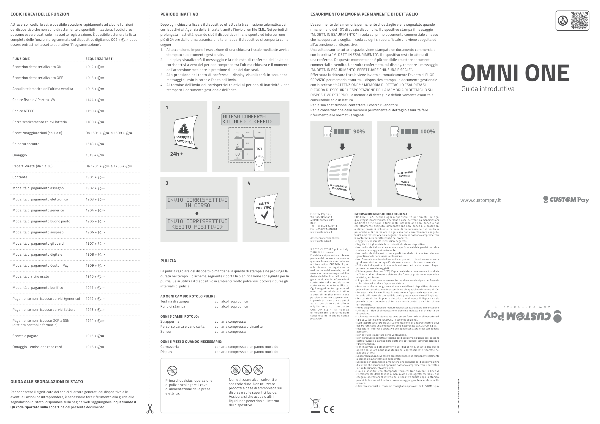
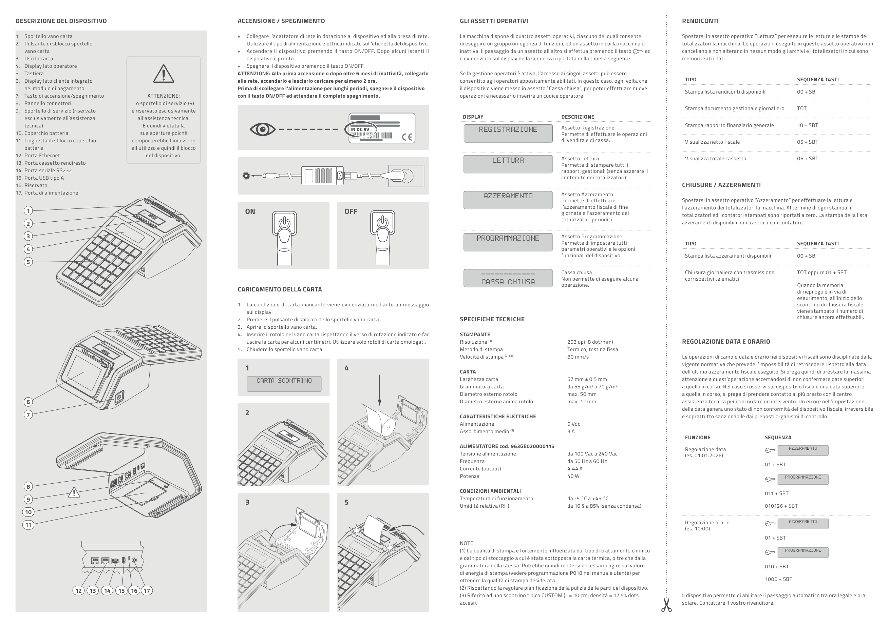

<!-- categoria assegnata per inferenza: verificare -->

# OMNI ONE - Guida introduttiva

Guida introduttiva del registratore telematico **OMNI ONE** (codice 0578100M000101, Rev. 1.10).

[Scarica la guida introduttiva (PDF)](assets/resources/0578100M000101_1.10.pdf)

## Descrizione del dispositivo

1. Sportello vano carta
2. Pulsante di sblocco sportello vano carta
3. Uscita carta
4. Display lato operatore
5. Tastiera
6. Display lato cliente integrato nel modulo di pagamento
7. Tasto di accensione/spegnimento
8. Pannello connettori
9. Sportello di servizio (riservato esclusivamente all'assistenza tecnica)
10. Coperchio batteria
11. Linguetta di sblocco coperchio batteria
12. Porta Ethernet
13. Porta cassetto rendiresto
14. Porta seriale RS232
15. Porta USB tipo A
16. Riservato
17. Porta di alimentazione

!!! warning "Attenzione"
    Lo sportello di servizio (9) è riservato esclusivamente all'assistenza tecnica. È quindi vietata la sua apertura poiché comporterebbe l'inibizione all'utilizzo e quindi il blocco del dispositivo.

## Accensione / spegnimento

- Collegare l'adattatore di rete in dotazione al dispositivo ed alla presa di rete. Utilizzare il tipo di alimentazione elettrica indicato sull'etichetta del dispositivo.
- Accendere il dispositivo premendo il tasto ON/OFF. Dopo alcuni istanti il dispositivo è pronto.
- Spegnere il dispositivo premendo il tasto ON/OFF.

!!! warning "Attenzione"
    Alla prima accensione o dopo oltre 6 mesi di inattività, collegarlo alla rete, accenderlo e lasciarlo caricare per almeno 2 ore. Prima di scollegare l'alimentazione per lunghi periodi, spegnere il dispositivo con il tasto ON/OFF ed attendere il completo spegnimento.

## Caricamento della carta

1. La condizione di carta mancante viene evidenziata mediante un messaggio sul display.
2. Premere il pulsante di sblocco dello sportello vano carta.
3. Aprire lo sportello vano carta.
4. Inserire il rotolo nel vano carta rispettando il verso di rotazione indicato e far uscire la carta per alcuni centimetri. Utilizzare solo rotoli di carta omologati.
5. Chiudere lo sportello vano carta.

## Gli assetti operativi

La macchina dispone di quattro assetti operativi, ciascuno dei quali consente di eseguire un gruppo omogeneo di funzioni, ed un assetto in cui la macchina è inattiva. Il passaggio da un assetto all'altro si effettua premendo il tasto evidenziato sul display nella sequenza riportata nella tabella seguente.

| Display | Descrizione |
|---------|-------------|
| REGISTRAZIONE | Assetto Registrazione: permette di effettuare le operazioni di vendita e di cassa. |
| LETTURA | Assetto Lettura: permette di stampare tutti i rapporti gestionali (senza azzerare il contenuto dei totalizzatori). |
| AZZERAMENTO | Assetto Azzeramento: permette di effettuare l'azzeramento fiscale di fine giornata e l'azzeramento dei totalizzatori periodici. |
| PROGRAMMAZIONE | Assetto Programmazione: permette di impostare tutti i parametri operativi e le opzioni funzionali del dispositivo. |
| CASSA CHIUSA | Non permette di eseguire alcuna operazione. |

Se la gestione operatori è attiva, l'accesso ai singoli assetti può essere consentito agli operatori appositamente abilitati. In questo caso, ogni volta che il dispositivo viene messo in assetto "Cassa chiusa", per poter effettuare nuove operazioni è necessario inserire un codice operatore.

## Rendiconti

Spostarsi in assetto operativo **Lettura** per eseguire le letture e le stampe dei totalizzatori della macchina. Le operazioni eseguite in questo assetto operativo non cancellano e non alterano in nessun modo gli archivi e i totalizzatori in cui sono memorizzati i dati.

| Tipo | Sequenza tasti |
|------|----------------|
| Stampa lista rendiconti disponibili | `00` + SBT |
| Stampa documento gestionale giornaliero | TOT |
| Stampa rapporto finanziario generale | `10` + SBT |
| Visualizza netto fiscale | `05` + SBT |
| Visualizza totale cassetto | `06` + SBT |

## Chiusure / azzeramenti

Spostarsi in assetto operativo **Azzeramento** per effettuare la lettura e l'azzeramento dei totalizzatori. Al termine di ogni stampa, i totalizzatori ed i contatori stampati sono riportati a zero. La stampa della lista azzeramenti disponibili non azzera alcun contatore.

| Tipo | Sequenza tasti |
|------|----------------|
| Stampa lista azzeramenti disponibili | `00` + SBT |
| Chiusura giornaliera con trasmissione corrispettivi telematici | TOT oppure `01` + SBT |

Quando la memoria di riepilogo è in via di esaurimento, all'inizio dello scontrino di chiusura fiscale viene stampato il numero di chiusure ancora effettuabili.

## Regolazione data e orario

!!! warning "Attenzione"
    Le operazioni di cambio data e orario nei dispositivi fiscali sono disciplinate dalla vigente normativa che prevede l'impossibilità di retrocedere rispetto alla data dell'ultimo azzeramento fiscale eseguito. Si prega quindi di prestare la massima attenzione a quest'operazione accertandosi di non confermare date superiori a quella in corso. Nel caso si osservi sul dispositivo fiscale una data superiore a quella in corso, si prega di prendere contatto al più presto con il centro assistenza tecnica per concordare un intervento. Un errore nell'impostazione della data genera uno stato di non conformità del dispositivo fiscale, irreversibile e soprattutto sanzionabile dai preposti organismi di controllo.

| Funzione | Assetto | Sequenza |
|----------|---------|----------|
| Regolazione data (es. 01.01.2026) | AZZERAMENTO, poi PROGRAMMAZIONE | `01` + SBT, poi `011` + SBT, poi `010126` + SBT |
| Regolazione orario (es. 10:00) | AZZERAMENTO, poi PROGRAMMAZIONE | `01` + SBT, poi `010` + SBT, poi `1000` + SBT |

Il dispositivo permette di abilitare il passaggio automatico tra ora legale e ora solare. Contattare il vostro rivenditore.

## Codici brevi delle funzioni

Attraverso i codici brevi è possibile accedere rapidamente ad alcune funzioni del dispositivo che non sono direttamente disponibili in tastiera. I codici brevi possono essere usati solo in assetto registrazione. È possibile ottenere la lista completa delle funzioni programmate sul dispositivo digitando `002` + SBT dopo essere entrati nell'assetto operativo "Programmazione".

| Funzione | Sequenza tasti |
|----------|----------------|
| Scontrino dematerializzato ON | `1012` + |
| Scontrino dematerializzato OFF | `1013` + |
| Annullo telematico dell'ultima vendita | `1015` + |
| Codice fiscale / Partita IVA | `1144` + |
| Codice ATECO | `1150` + |
| Forza scaricamento chiavi lotteria | `1180` + |
| Sconti/maggiorazioni (da 1 a 8) | Da `1501` + a `1508` + |
| Saldo su acconto | `1518` + |
| Omaggio | `1519` + |
| Reparti diretti (da 1 a 30) | Da `1701` + a `1730` + |
| Contante | `1901` + |
| Modalità di pagamento assegno | `1902` + |
| Modalità di pagamento elettronico | `1903` + |
| Modalità di pagamento generico | `1904` + |
| Modalità di pagamento buono pasto | `1905` + |
| Modalità di pagamento sospeso | `1906` + |
| Modalità di pagamento gift card | `1907` + |
| Modalità di pagamento digitale | `1908` + |
| Modalità di pagamento CustomPay | `1909` + |
| Modalità di ritiro usato | `1910` + |
| Modalità di pagamento bonifico | `1911` + |
| Pagamento non riscosso servizi (generico) | `1912` + |
| Pagamento non riscosso servizi fatture | `1913` + |
| Pagamento non riscosso DCR a SSN (distinta contabile farmacie) | `1914` + |
| Sconto a pagare | `1915` + |
| Omaggio - emissione reso card | `1916` + |

## Periodo inattivo

Dopo ogni chiusura fiscale il dispositivo effettua la trasmissione telematica dei corrispettivi all'Agenzia delle Entrate tramite l'invio di un file XML. Nei periodi di prolungata inattività, quando cioè il dispositivo rimane spento ed intercorrono più di 24 ore dall'ultima trasmissione telematica, il dispositivo si comporta come segue:

1. All'accensione, impone l'esecuzione di una chiusura fiscale mediante avviso stampato su documento gestionale.
2. Il display visualizzerà il messaggio e la richiesta di conferma dell'invio dei corrispettivi a zero del periodo compreso tra l'ultima chiusura e il momento dell'accensione mediante la pressione di uno dei due tasti (TOTALE / FEED).
3. Alla pressione del tasto di conferma il display visualizzerà in sequenza i messaggi di invio in corso e l'esito dell'invio.
4. Al termine dell'invio dei corrispettivi relativi al periodo di inattività viene stampato il documento gestionale dell'esito.

## Esaurimento memoria permanente di dettaglio

L'esaurimento della memoria permanente di dettaglio viene segnalato quando rimane meno del 10% di spazio disponibile. Il dispositivo stampa il messaggio "M. DETT. IN ESAURIMENTO" in coda sul primo documento commerciale emesso che ha superato la soglia, in coda ad ogni chiusura fiscale che viene eseguita ed all'accensione del dispositivo.

Una volta esaurito tutto lo spazio, viene stampato un documento commerciale con la scritta "M. DETT. IN ESAURIMENTO", il dispositivo resta in attesa di una conferma. Da questo momento non è più possibile emettere documenti commerciali di vendita. Una volta confermato, sul display compare il messaggio "M. DETT. IN ESAURIMENTO, EFFETTUARE CHIUSURA FISCALE".

Effettuata la chiusura fiscale viene inviato automaticamente l'evento di FUORI SERVIZIO per memoria esaurita. Il dispositivo stampa un documento gestionale con la scritta: ***ATTENZIONE*** MEMORIA DI DETTAGLIO ESAURITA! SI RICORDA DI ESEGUIRE L'ESPORTAZIONE DELLA MEMORIA DI DETTAGLIO SUL DISPOSITIVO ESTERNO. La memoria di dettaglio è definitivamente esaurita e consultabile solo in lettura.

Per la sua sostituzione, contattare il vostro rivenditore. Per la conservazione della memoria permanente di dettaglio esaurita fare riferimento alle normative vigenti.

## Pulizia

La pulizia regolare del dispositivo mantiene la qualità di stampa e ne prolunga la durata nel tempo. Lo schema seguente riporta la pianificazione consigliata per la pulizia. Se si utilizza il dispositivo in ambienti molto polverosi, occorre ridurre gli intervalli di pulizia.

| Frequenza | Parte | Modalità |
|-----------|-------|----------|
| Ad ogni cambio rotolo | Testina di stampa | con alcol isopropilico |
| Ad ogni cambio rotolo | Rullo di stampa | con alcol isopropilico |
| Ogni 5 cambi rotolo | Strapperina | con aria compressa o pinzette |
| Ogni 5 cambi rotolo | Percorso carta e vano carta, Sensori | con aria compressa |
| Ogni 6 mesi o quando necessario | Carrozzeria | con aria compressa o un panno morbido |
| Ogni 6 mesi o quando necessario | Display | con aria compressa o un panno morbido |

!!! warning "Attenzione"
    Prima di qualsiasi operazione di pulizia scollegare il cavo di alimentazione dalla presa elettrica. Non utilizzare alcol, solventi o spazzole dure. Non utilizzare prodotti a base di ammoniaca sui display e sulle superfici lucide. Assicurarsi che acqua o altri liquidi non penetrino all'interno del dispositivo.

## Specifiche tecniche

| Sezione | Caratteristica | Valore |
|---------|----------------|--------|
| Stampante | Risoluzione (1) | 203 dpi (8 dot/mm) |
| Stampante | Metodo di stampa | Termico, testina fissa |
| Stampante | Velocità di stampa (2) (3) | 80 mm/s |
| Carta | Larghezza carta | 57 mm ± 0.5 mm |
| Carta | Grammatura carta | da 55 g/m² a 70 g/m² |
| Carta | Diametro esterno rotolo | max. 50 mm |
| Carta | Diametro esterno anima rotolo | max. 12 mm |
| Caratteristiche elettriche | Alimentazione | 9 Vdc, 3A |
| Caratteristiche elettriche | Assorbimento medio (3) | 4.44 A |
| Alimentatore cod. 963GE020000115 | Tensione alimentazione | da 100 Vac a 240 Vac |
| Alimentatore cod. 963GE020000115 | Frequenza | da 50 Hz a 60 Hz |
| Alimentatore cod. 963GE020000115 | Corrente (output) | 4.44 A |
| Alimentatore cod. 963GE020000115 | Potenza | 40 W |
| Condizioni ambientali | Temperatura di funzionamento | da -5 °C a +45 °C |
| Condizioni ambientali | Umidità relativa (RH) | da 10 % a 85% (senza condensa) |

**Note**

1. La qualità di stampa è fortemente influenzata dal tipo di trattamento chimico e dal tipo di stoccaggio a cui è stata sottoposta la carta termica, oltre che dalla grammatura della stessa. Potrebbe quindi rendersi necessario agire sul valore di energia di stampa (vedere programmazione P018 nel manuale utente) per ottenere la qualità di stampa desiderata.
2. Rispettando la regolare pianificazione della pulizia delle parti del dispositivo.
3. Riferito ad uno scontrino tipico CUSTOM (L = 10 cm, densità = 12.5% dots accesi).

<!-- i valori di alimentazione/assorbimento derivano da un'estrazione testuale con layout a colonne: verificare sul PDF originale -->

## Guida alle segnalazioni di stato

Per conoscere il significato dei codici di errore generati dal dispositivo e le eventuali azioni da intraprendere, è necessario fare riferimento alla guida alle segnalazioni di stato, disponibile sulla pagina web raggiungibile inquadrando il QR code riportato sulla copertina del documento originale.

## Informazioni generali sulla sicurezza

CUSTOM S.p.A. declina ogni responsabilità per sinistri od ogni qualsivoglia inconveniente, a persone o cose, derivanti da manomissioni, modifiche strutturali o funzionali, installazione non idonea o non correttamente eseguita, ambientazione non idonea alle protezioni o climatizzazioni richieste, carenze di manutenzione o di verifiche periodiche o di riparazioni in ogni caso non correttamente eseguite.

Si richiama l'attenzione sulle seguenti azioni che possono compromettere la conformità e le caratteristiche del prodotto:

- Leggete e conservate le istruzioni seguenti.
- Seguite tutti gli avvisi e le istruzioni indicate sul dispositivo.
- Non collocate il dispositivo su una superficie instabile perché potrebbe cadere e danneggiarsi seriamente.
- Non collocate il dispositivo su superfici morbide o in ambienti che non garantiscono la necessaria ventilazione.
- Non fissare in maniera indissolubile un prodotto o i suoi accessori come gli alimentatori se non specificatamente previsto da questo manuale.
- Collocate il dispositivo in modo da evitare che i cavi ad esso collegati possano essere danneggiati.
- [Solo apparecchiature OEM] L'apparecchiatura deve essere installata all'interno di un chiosco o sistema che fornisca protezione meccanica, elettrica, antifuoco.
- L'impianto di rete deve essere conforme alle norme in vigore nel Paese in cui si intende installare l'apparecchiatura.
- Assicurarsi che nel luogo in cui si vuole installare il dispositivo, vi sia una presa di corrente facilmente accessibile e di capacità non inferiore ai 10A.
- Accertarsi che il cavo di rete in dotazione all'apparecchiatura, o che si intende utilizzare, sia compatibile con la presa disponibile nell'impianto.
- Assicuratevi che l'impianto elettrico che alimenta il dispositivo sia provvisto del conduttore di terra e che sia protetto da interruttore differenziale.
- Prima di ogni operazione di manutenzione scollegare il cavo alimentazione.
- Utilizzate il tipo di alimentazione elettrica indicato sull'etichetta del dispositivo.
- L'alimentazione alla stampante deve essere fornita da un alimentatore di tipo SELV (definizione IEC60950-1 seconda edizione).
- [Solo apparecchiature DESK] L'alimentazione all'apparecchiatura deve essere fornita da un alimentatore di tipo approvato da CUSTOM S.p.A.
- Rispettare l'intervallo operativo dell'apparecchiatura e dei componenti accessori.
- Non ostruite le aperture per la ventilazione.
- Non introducete oggetti all'interno del dispositivo in quanto essi possono cortocircuitare o danneggiare parti che potrebbero comprometterne il funzionamento.
- Non intervenite personalmente sul dispositivo, eccetto che per le operazioni di ordinaria manutenzione, espressamente riportate nel manuale utente.
- L'apparecchiatura deve essere accessibile nelle sue componenti solamente a personale autorizzato ed addestrato.
- Eseguire periodicamente la manutenzione ordinaria del dispositivo al fine di evitare che accumuli di sporcizia possano compromettere il corretto e sicuro funzionamento dell'unità.
- [Solo dispositivi con stampante termica] Non toccare la linea di riscaldamento della testina a mani nude o con oggetti metallici. Non eseguire operazioni all'interno del dispositivo subito dopo la stampa, perché la testina ed il motore possono raggiungere temperature molto elevate.
- Utilizzare materiali di consumo consigliati o approvati da CUSTOM S.p.A.

## Contatti

CUSTOM Pay S.r.l. - Via Isaac Newton 4, 43010 Fontevivo (PR), Italy - Tel. +39 0521-680111 - Fax +39 0521-610701 - [www.custompay.it](https://www.custompay.it)

Assistenza Tecnica Clienti: [www.custom4u.it](https://www.custom4u.it)

© 2026 CUSTOM S.p.A. - Italy. Tutti i diritti riservati.

## Pagine originali

