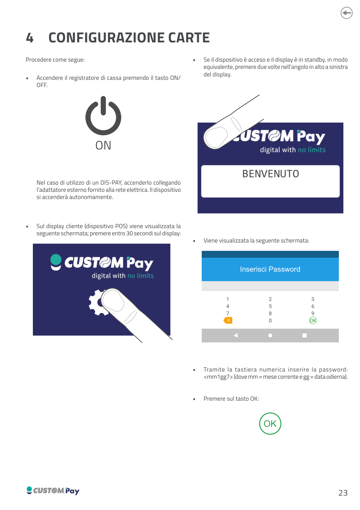
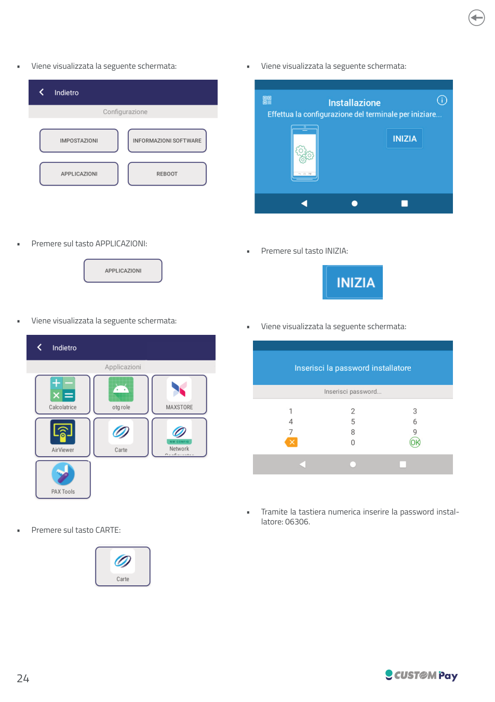
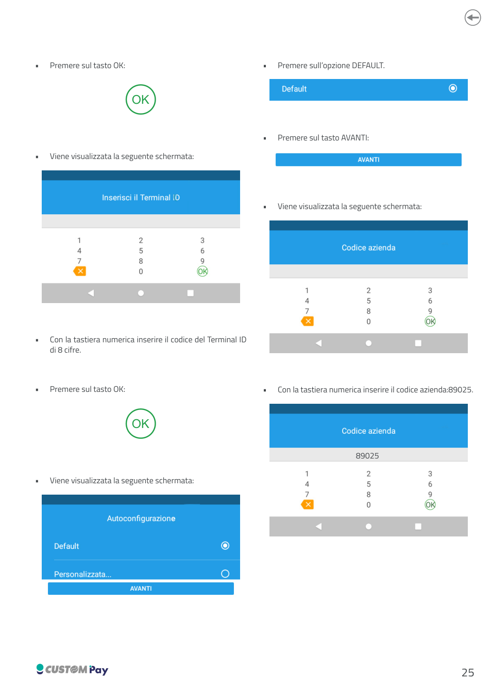
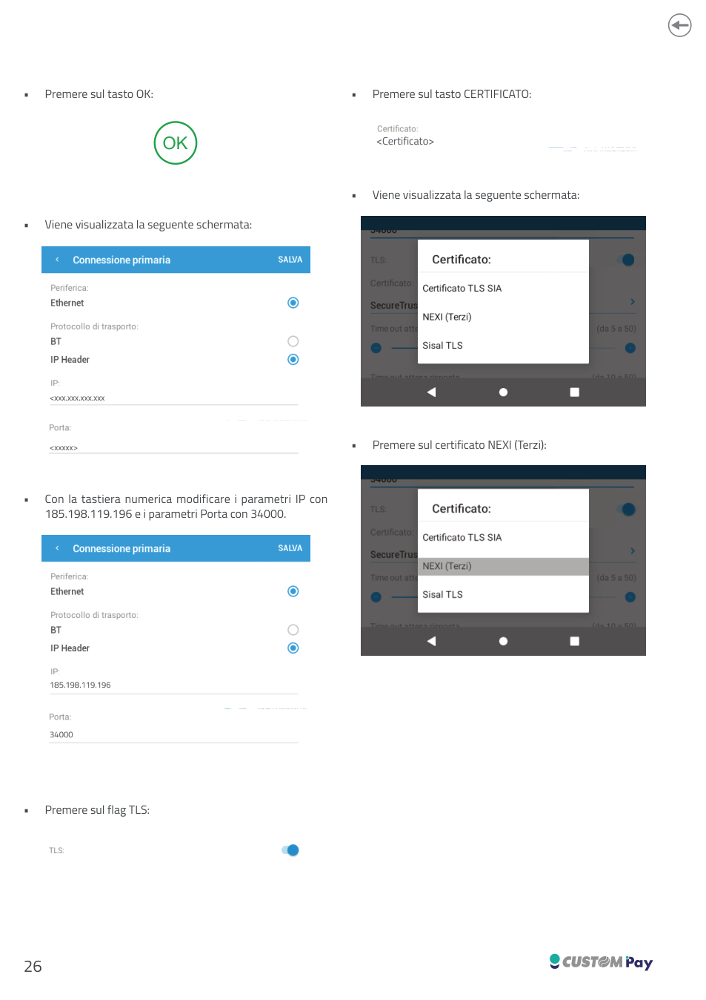
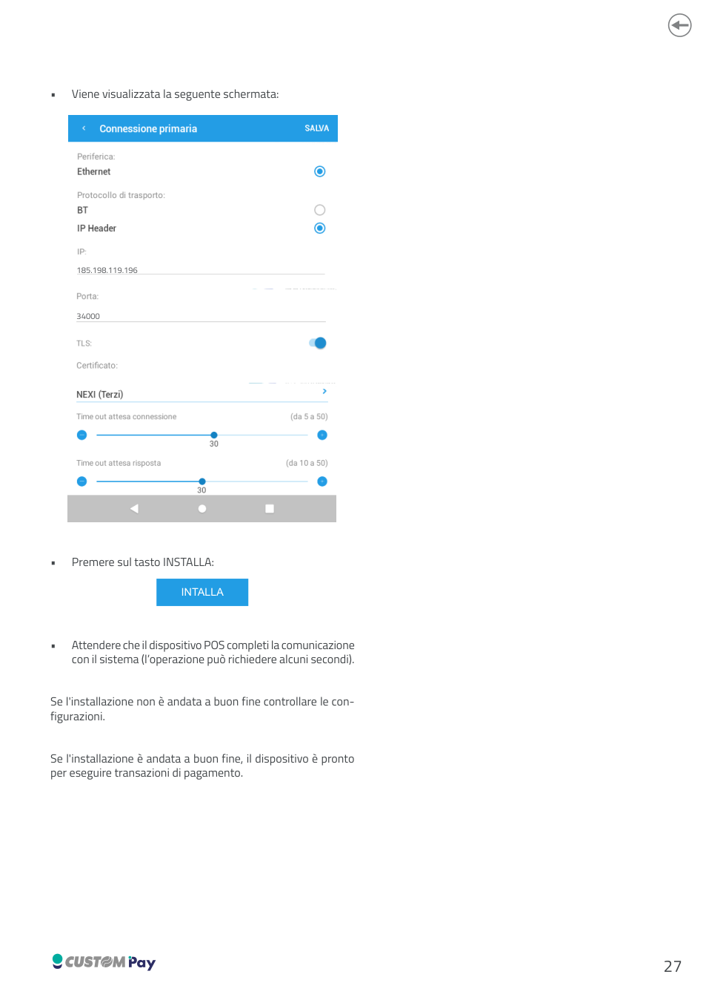
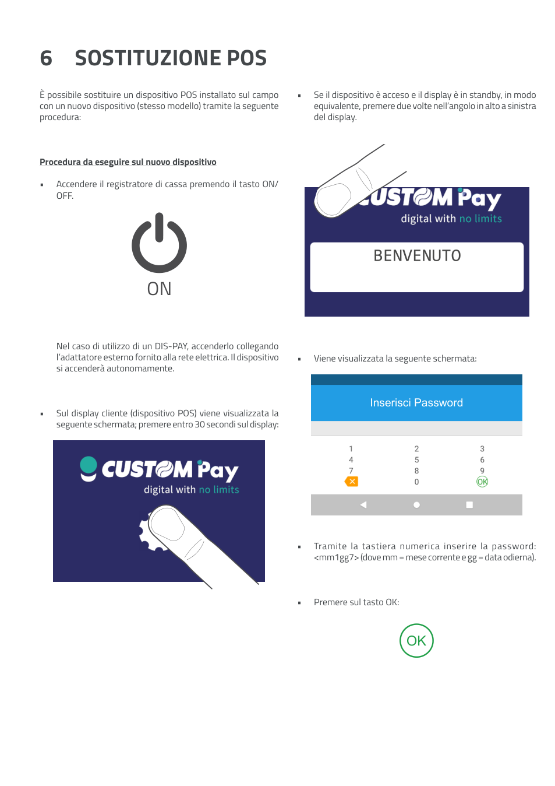
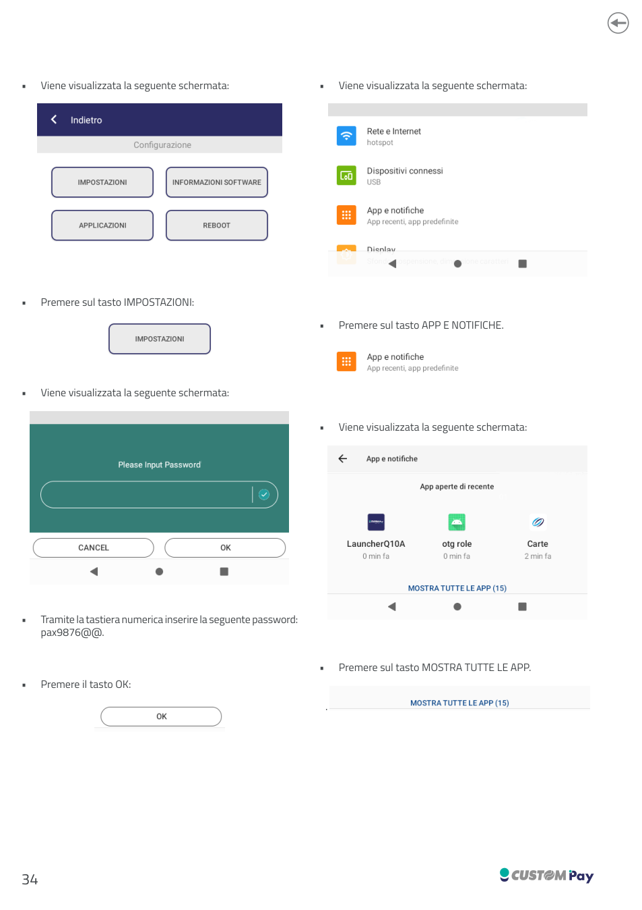
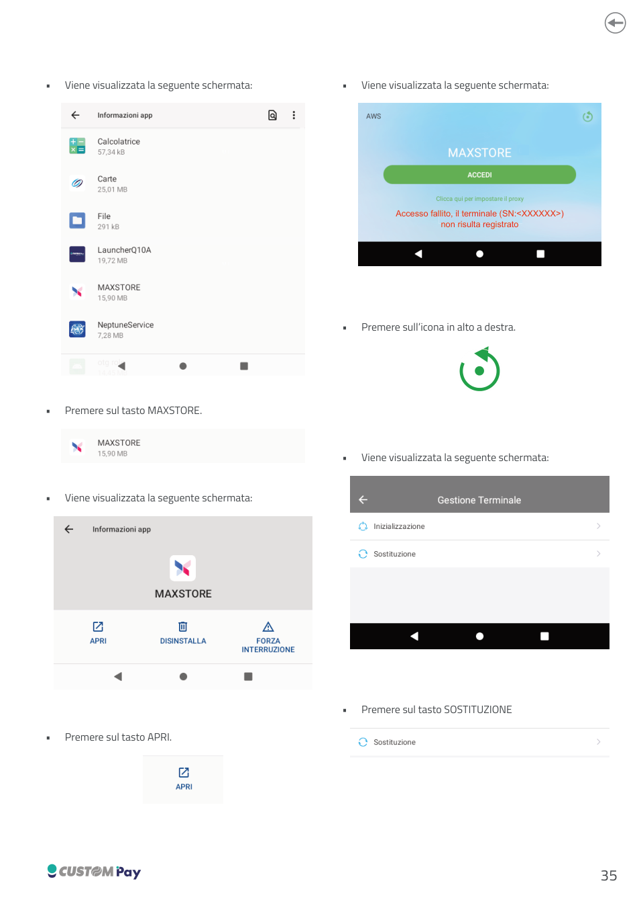
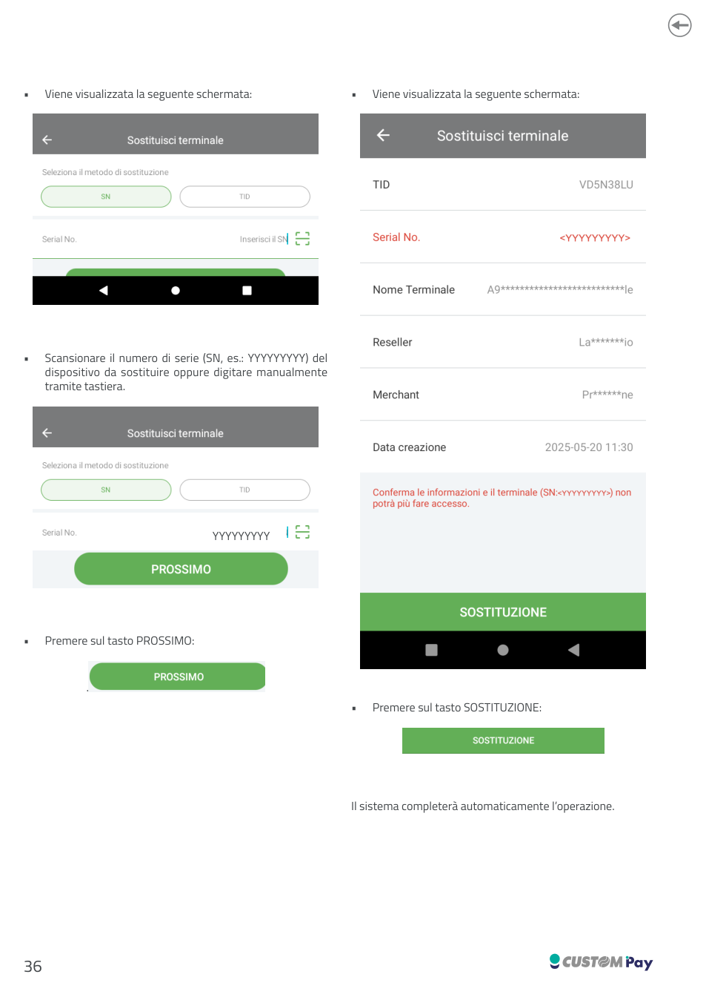
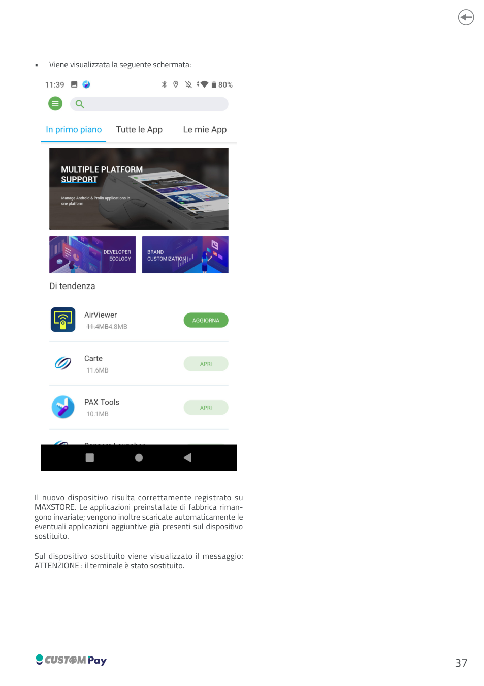

<!-- categoria assegnata per inferenza: verificare -->
<!-- pagina ricostruita esclusivamente dai capitoli 4 (Configurazione carte) e 6 (Sostituzione POS) del manuale 0576100M000218 Rev. 2.00 -->

# Configurazione carte e sostituzione POS

Questa pagina riunisce due procedure del manuale di configurazione del POS **Q10A** (Custom Pay):

| Procedura | Quando serve |
|-----------|--------------|
| [Configurazione carte](#configurazione-carte) | Installazione dell'applicazione CARTE sul POS: Terminal ID, codice azienda e parametri di connessione al sistema di pagamento |
| [Sostituzione POS](#sostituzione-pos) | Sostituzione sul campo di un POS installato con un nuovo dispositivo dello stesso modello |

Entrambe le procedure partono dall'accesso al menù di configurazione del POS descritto qui sotto.

[Scarica il manuale completo (PDF)](assets/resources/0576100M000218_2.00.pdf)

## Accesso al menù di configurazione del POS

Il punto di partenza è identico per le due procedure.

1. Accendere il registratore di cassa premendo il tasto **ON/OFF**.

    !!! note "DIS-PAY"
        Nel caso di utilizzo di un DIS-PAY, accenderlo collegando l'adattatore esterno fornito alla rete elettrica. Il dispositivo si accenderà autonomamente.

2. Sul display cliente (dispositivo POS) viene visualizzata la schermata **BENVENUTO** di Custom Pay: premere sul display **entro 30 secondi**.
3. Se il dispositivo è acceso e il display è in standby, in modo equivalente, premere **due volte nell'angolo in alto a sinistra** del display.
4. Viene visualizzata la schermata **Inserisci Password**. Tramite la tastiera numerica inserire la password `mm1gg7`, dove `mm` = mese corrente e `gg` = data odierna.
5. Premere sul tasto **OK**.

!!! tip "Esempio"
    Il 22 ottobre la password è `101227`.

---

## Configurazione carte

Procedere come segue, dopo aver eseguito l'[accesso al menù di configurazione](#accesso-al-menu-di-configurazione-del-pos).

### 1. Aprire l'applicazione CARTE

1. Viene visualizzata la schermata **Configurazione** con i tasti IMPOSTAZIONI, INFORMAZIONI SOFTWARE, APPLICAZIONI e REBOOT. Premere sul tasto **APPLICAZIONI**.
2. Viene visualizzata la schermata **Applicazioni** (Calcolatrice, otg role, MAXSTORE, AirViewer, Carte, Network, PAX Tools). Premere sul tasto **CARTE**.
3. Viene visualizzata la schermata **Installazione** ("Effettua la configurazione del terminale per iniziare..."). Premere sul tasto **INIZIA**.
4. Viene visualizzata la schermata **Inserisci la password installatore**. Tramite la tastiera numerica inserire la password installatore: `06306`.
5. Premere sul tasto **OK**.

### 2. Terminal ID e autoconfigurazione

1. Viene visualizzata la schermata **Inserisci il Terminal ID**. Con la tastiera numerica inserire il codice del **Terminal ID di 8 cifre** e premere **OK**.
2. Viene visualizzata la schermata **Autoconfigurazione**, con le opzioni *Default* e *Personalizzata...*. Premere sull'opzione **DEFAULT**.
3. Premere sul tasto **AVANTI**.
4. Viene visualizzata la schermata **Codice azienda**. Con la tastiera numerica inserire il codice azienda `89025` e premere **OK**.

### 3. Connessione primaria

Viene visualizzata la schermata **Connessione primaria**, con i seguenti campi:

| Campo | Valore |
|-------|--------|
| Periferica | Ethernet |
| Protocollo di trasporto | IP Header (selezionato; l'alternativa è BT) |
| IP | `xxx.xxx.xxx.xxx` (da modificare) |
| Porta | `xxxxx` (da modificare) |

1. Con la tastiera numerica modificare i parametri **IP** con `185.198.119.196` e i parametri **Porta** con `34000`.
2. Premere sul flag **TLS**.
3. Premere sul tasto **CERTIFICATO**. Viene visualizzato l'elenco: *Certificato TLS SIA*, *NEXI (Terzi)*, *Sisal TLS*.
4. Premere sul certificato **NEXI (Terzi)**.
5. Nella schermata finale controllare i campi: IP `185.198.119.196`, Porta `34000`, TLS attivo, Certificato **NEXI (Terzi)**, *Time out attesa connessione* (da 5 a 50, valore mostrato: 30) e *Time out attesa risposta* (da 10 a 50, valore mostrato: 30).

### 4. Installare

1. Premere sul tasto **INSTALLA**.
2. Attendere che il dispositivo POS completi la comunicazione con il sistema (l'operazione può richiedere alcuni secondi).

!!! note "Esito dell'installazione"
    Se l'installazione non è andata a buon fine controllare le configurazioni. Se l'installazione è andata a buon fine, il dispositivo è pronto per eseguire transazioni di pagamento.

### Riepilogo parametri

| Parametro | Valore |
|-----------|--------|
| Password dinamica di accesso | `mm1gg7` |
| Password installatore | `06306` |
| Terminal ID | codice di 8 cifre |
| Autoconfigurazione | Default |
| Codice azienda | `89025` |
| Periferica | Ethernet |
| Protocollo di trasporto | IP Header |
| IP | `185.198.119.196` |
| Porta | `34000` |
| TLS | Attivo |
| Certificato | NEXI (Terzi) |

---

## Sostituzione POS

È possibile sostituire un dispositivo POS installato sul campo con un nuovo dispositivo (**stesso modello**) tramite la seguente procedura. Le operazioni vanno eseguite **sul nuovo dispositivo**.

!!! warning "Attenzione"
    Per sostituire il POS occorre disporre del numero di serie (SN) del dispositivo **da sostituire**: può essere scansionato oppure digitato manualmente.

### 1. Accedere alle impostazioni

1. Eseguire l'[accesso al menù di configurazione](#accesso-al-menu-di-configurazione-del-pos) sul nuovo dispositivo (password `mm1gg7`).
2. Viene visualizzata la schermata **Configurazione**. Premere sul tasto **IMPOSTAZIONI**.
3. Viene visualizzata la schermata **Please Input Password**. Tramite la tastiera numerica inserire la seguente password: `pax9876@@.`
4. Premere il tasto **OK**.

### 2. Aprire MAXSTORE

1. Viene visualizzata la schermata delle impostazioni (Rete e Internet, Dispositivi connessi, App e notifiche, Display). Premere sul tasto **APP E NOTIFICHE**.
2. Viene visualizzata la schermata **App e notifiche** con le app aperte di recente. Premere sul tasto **MOSTRA TUTTE LE APP**.
3. Viene visualizzato l'elenco delle app (Calcolatrice, Carte, File, LauncherQ10A, MAXSTORE, NeptuneService, ...). Premere sul tasto **MAXSTORE**.
4. Viene visualizzata la schermata **Informazioni app** di MAXSTORE (APRI, DISINSTALLA, FORZA INTERRUZIONE). Premere sul tasto **APRI**.

### 3. Avviare la sostituzione

1. Viene visualizzata la schermata di MAXSTORE con il messaggio: *Accesso fallito, il terminale (SN:XXXXXX) non risulta registrato*. Premere sull'**icona in alto a destra**.
2. Viene visualizzata la schermata **Gestione Terminale**, con le voci *Inizializzazione* e *Sostituzione*. Premere sul tasto **SOSTITUZIONE**.
3. Viene visualizzata la schermata **Sostituisci terminale**, con il metodo di sostituzione **SN** (alternativa: TID). Scansionare il numero di serie (SN, es. `YYYYYYYYY`) del dispositivo da sostituire oppure digitarlo manualmente tramite tastiera.
4. Premere sul tasto **PROSSIMO**.
5. Viene visualizzata la schermata di conferma con i dati del terminale da sostituire: TID, Serial No., Nome Terminale, Reseller, Merchant e Data creazione. Premere sul tasto **SOSTITUZIONE**.
6. Il sistema completerà automaticamente l'operazione.

### 4. Esito

Viene visualizzata la schermata di MAXSTORE con le app **AirViewer**, **Carte** e **PAX Tools**.

!!! note "Esito della sostituzione"
    Il nuovo dispositivo risulta correttamente registrato su MAXSTORE. Le applicazioni preinstallate di fabbrica rimangono invariate; vengono inoltre scaricate automaticamente le eventuali applicazioni aggiuntive già presenti sul dispositivo sostituito.

    Sul dispositivo sostituito viene visualizzato il messaggio: *ATTENZIONE: il terminale è stato sostituito.*
