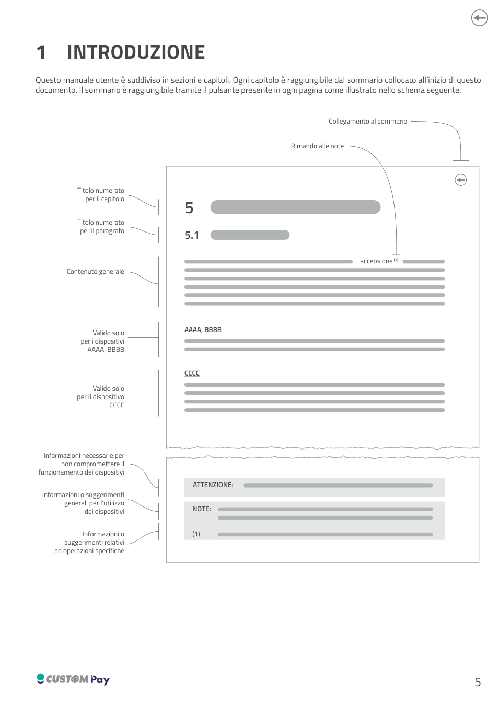
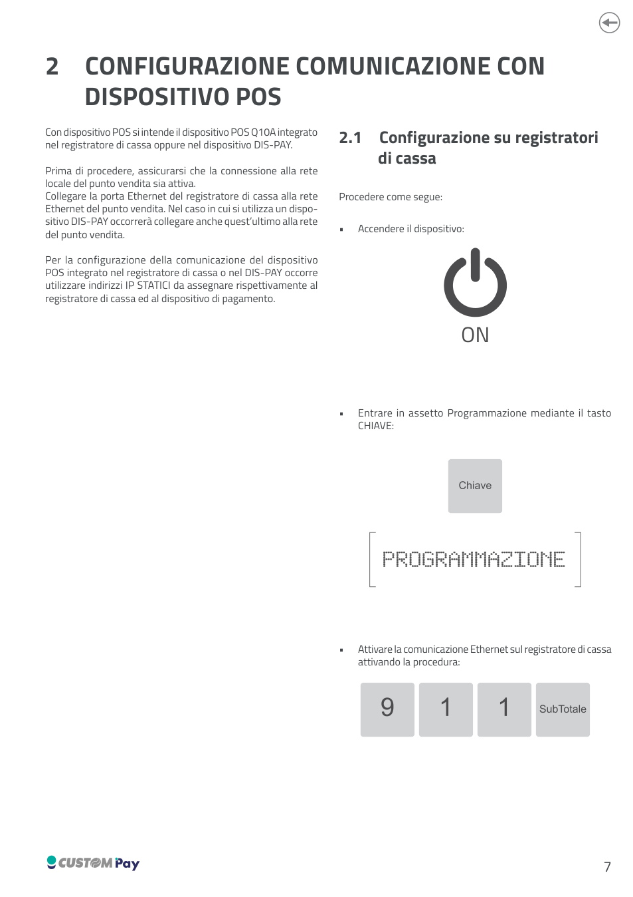
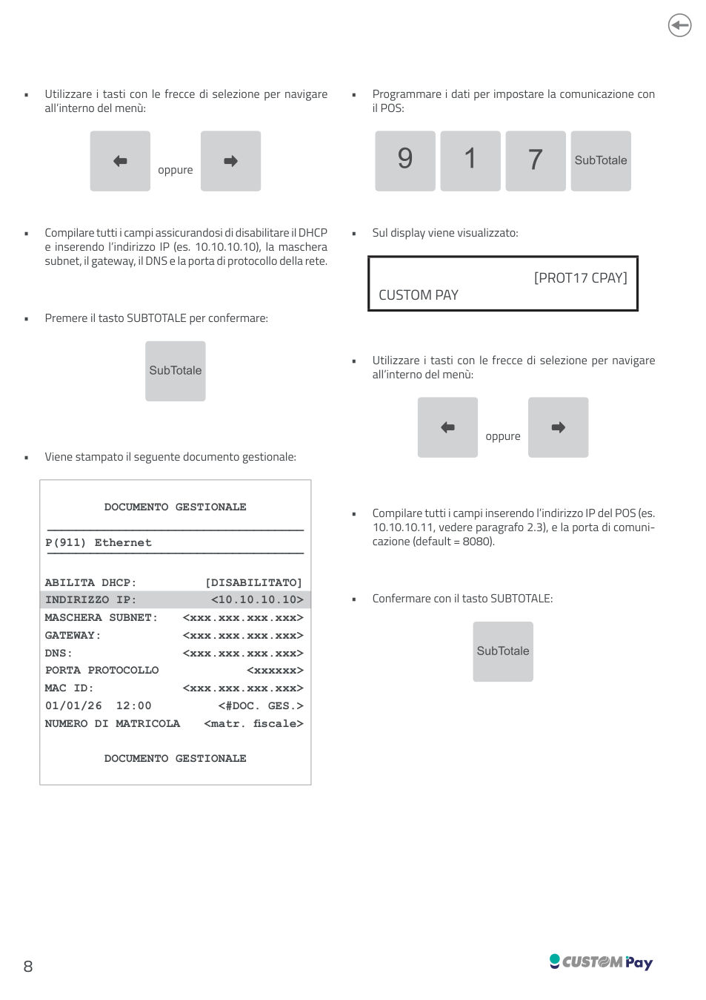
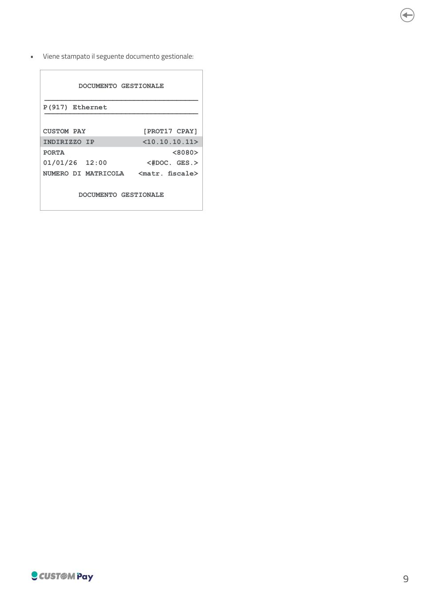
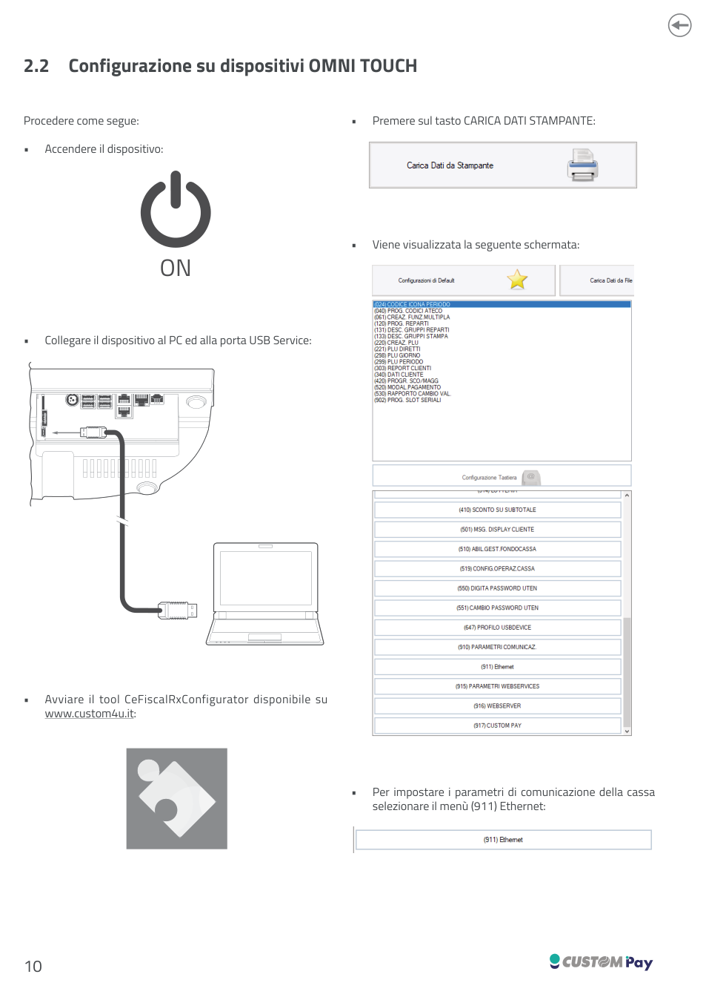
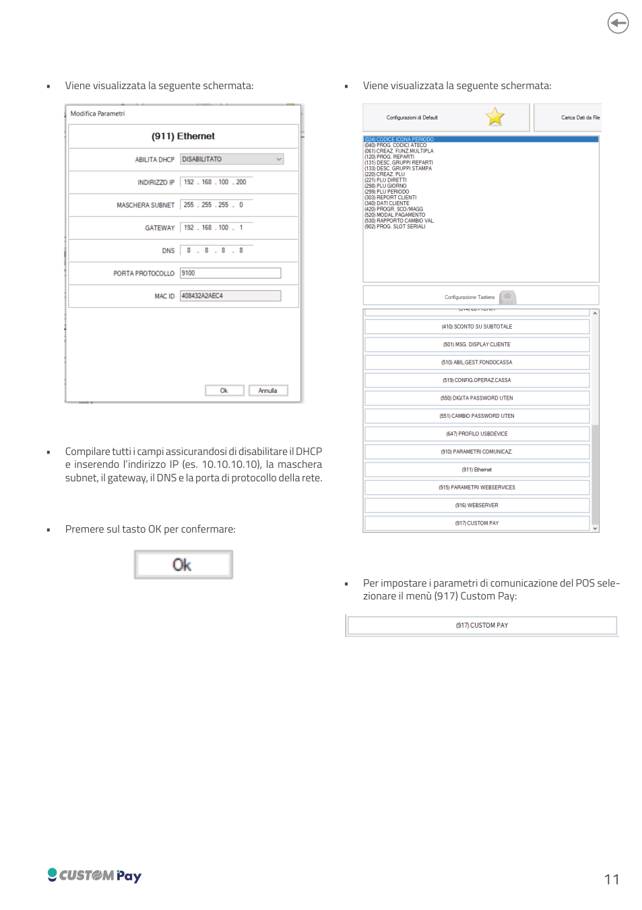
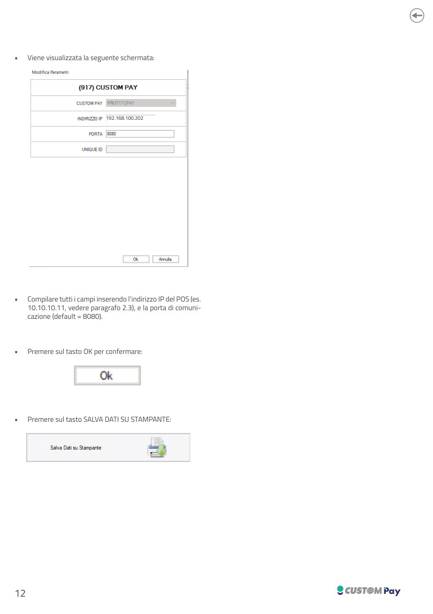
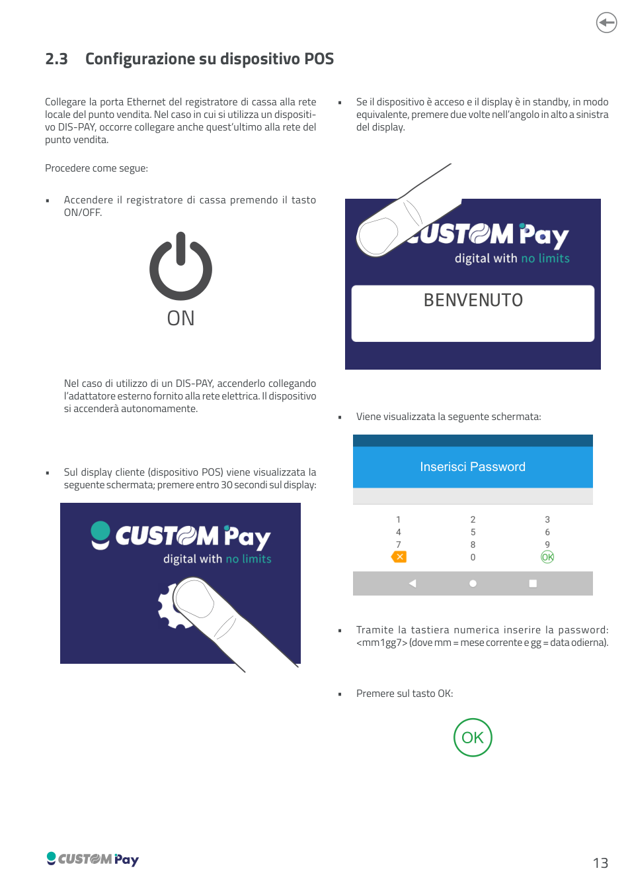
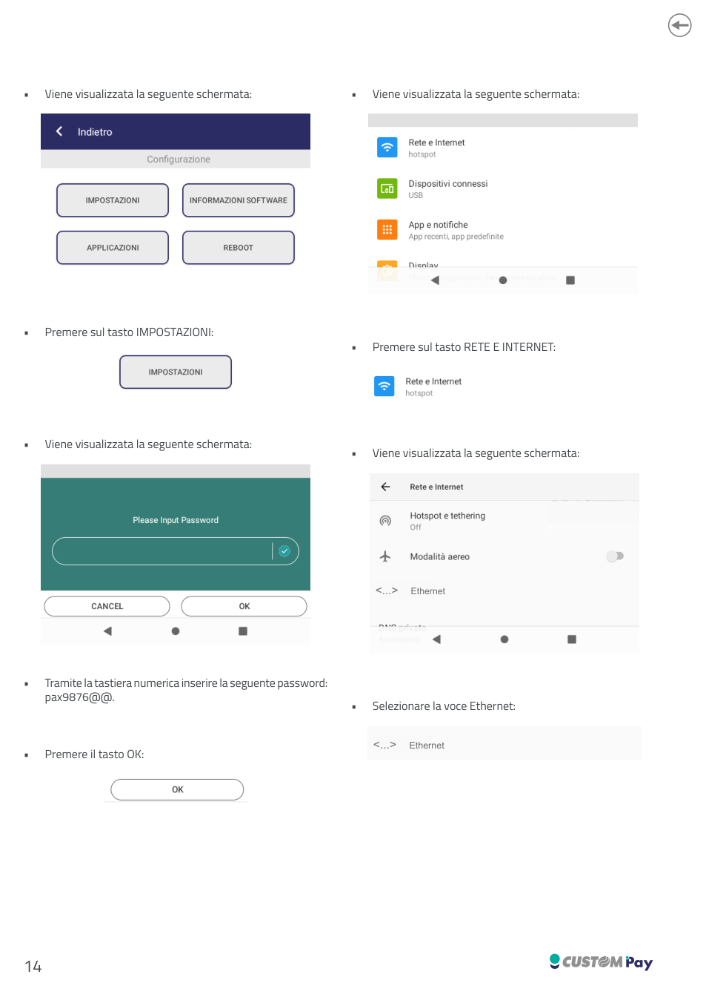
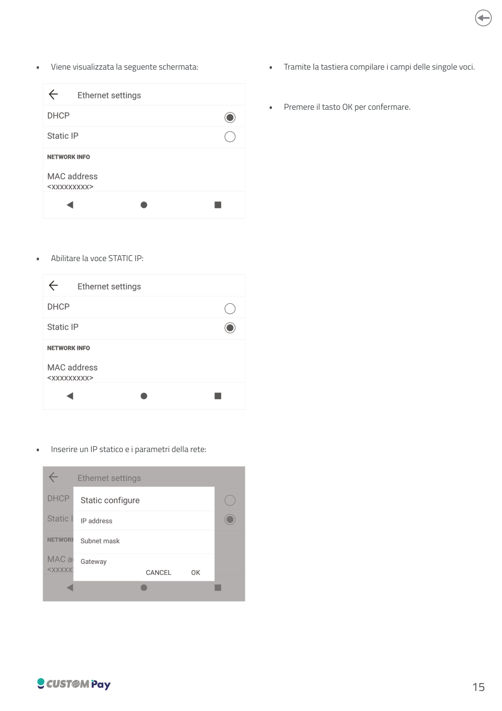

<!-- categoria assegnata per inferenza: verificare -->

# Configurazione comunicazione con dispositivo POS

## 1. Introduzione

Il manuale di configurazione del POS **Q10A** è suddiviso in sezioni e capitoli. Ogni capitolo è raggiungibile dal sommario collocato all'inizio del documento originale, a sua volta raggiungibile tramite il pulsante presente in ogni pagina.

Nel documento originale sono utilizzate le seguenti convenzioni grafiche:

- **ATTENZIONE**: informazioni necessarie per non compromettere il funzionamento dei dispositivi.
- **NOTE**: informazioni o suggerimenti generali per l'utilizzo dei dispositivi.
- Informazioni o suggerimenti relativi ad operazioni specifiche.
- Indicazioni "Valido solo per i dispositivi ..." per i contenuti riferiti a modelli specifici.



[Scarica il manuale completo (PDF)](assets/resources/0576100M000218_2.00.pdf)

## 2. Configurazione comunicazione con dispositivo POS

Con *dispositivo POS* si intende il dispositivo POS Q10A integrato nel registratore di cassa oppure nel dispositivo DIS-PAY.

Prima di procedere, assicurarsi che la connessione alla rete locale del punto vendita sia attiva. Collegare la porta Ethernet del registratore di cassa alla rete Ethernet del punto vendita. Nel caso in cui si utilizzi un dispositivo DIS-PAY occorrerà collegare anche quest'ultimo alla rete del punto vendita.

!!! warning "Attenzione"
    Per la configurazione della comunicazione del dispositivo POS integrato nel registratore di cassa o nel DIS-PAY occorre utilizzare indirizzi IP **STATICI** da assegnare rispettivamente al registratore di cassa ed al dispositivo di pagamento.

### 2.1 Configurazione su registratori di cassa

1. Accendere il dispositivo con il tasto ON/OFF.
2. Entrare in assetto **Programmazione** mediante il tasto CHIAVE.
3. Attivare la comunicazione Ethernet sul registratore di cassa attivando la procedura (911) Ethernet. Utilizzare i tasti con le frecce di selezione per navigare all'interno del menù.
4. Compilare tutti i campi assicurandosi di **disabilitare il DHCP** e inserendo l'indirizzo IP (es. `10.10.10.10`), la maschera subnet, il gateway, il DNS e la porta di protocollo della rete.
5. Premere il tasto **SUBTOTALE** per confermare.
6. Viene stampato il seguente documento gestionale:

    ```text
    DOCUMENTO GESTIONALE
    P (911) Ethernet
    ABILITA DHCP:      [DISABILITATO]
    INDIRIZZO IP:      <10.10.10.10>
    MASCHERA SUBNET:   <xxx.xxx.xxx.xxx>
    GATEWAY:           <xxx.xxx.xxx.xxx>
    DNS:               <xxx.xxx.xxx.xxx>
    PORTA PROTOCOLLO   <xxxxxx>
    MAC ID:            <xxx.xxx.xxx.xxx>
    01/01/26 12:00     <#DOC. GES.>
    NUMERO DI MATRICOLA <matr. fiscale>
    ```

7. Programmare i dati per impostare la comunicazione con il POS. Sul display viene visualizzato `[PROT17 CPAY]` - **CUSTOM PAY**.
8. Utilizzare i tasti con le frecce di selezione per navigare all'interno del menù.
9. Compilare tutti i campi inserendo l'indirizzo IP del POS (es. `10.10.10.11`, vedere [paragrafo 2.3](#23-configurazione-su-dispositivo-pos)) e la porta di comunicazione (default = `8080`).
10. Confermare con il tasto **SUBTOTALE**. Viene stampato il seguente documento gestionale:

    ```text
    DOCUMENTO GESTIONALE
    P (917) Ethernet
    CUSTOM PAY          [PROT17 CPAY]
    INDIRIZZO IP        <10.10.10.11>
    PORTA               <8080>
    01/01/26 12:00      <#DOC. GES.>
    NUMERO DI MATRICOLA <matr. fiscale>
    ```







### 2.2 Configurazione su dispositivi OMNI TOUCH

1. Accendere il dispositivo.
2. Collegare il dispositivo al PC ed alla porta **USB Service**.
3. Avviare il tool **CeFiscalRxConfigurator** disponibile su [www.custom4u.it](https://www.custom4u.it).
4. Premere sul tasto **CARICA DATI STAMPANTE**; viene visualizzata la schermata di configurazione.
5. Per impostare i parametri di comunicazione della cassa selezionare il menù **(911) Ethernet**.
6. Compilare tutti i campi assicurandosi di **disabilitare il DHCP** e inserendo l'indirizzo IP (es. `10.10.10.10`), la maschera subnet, il gateway, il DNS e la porta di protocollo della rete.
7. Premere sul tasto **OK** per confermare.
8. Per impostare i parametri di comunicazione del POS selezionare il menù **(917) Custom Pay**.
9. Compilare tutti i campi inserendo l'indirizzo IP del POS (es. `10.10.10.11`, vedere [paragrafo 2.3](#23-configurazione-su-dispositivo-pos)) e la porta di comunicazione (default = `8080`).
10. Premere sul tasto **OK** per confermare.
11. Premere sul tasto **SALVA DATI SU STAMPANTE**.







### 2.3 Configurazione su dispositivo POS

Collegare la porta Ethernet del registratore di cassa alla rete locale del punto vendita. Nel caso in cui si utilizzi un dispositivo DIS-PAY, occorre collegare anche quest'ultimo alla rete del punto vendita.

1. Accendere il registratore di cassa premendo il tasto **ON/OFF**. Nel caso di utilizzo di un DIS-PAY, accenderlo collegando l'adattatore esterno fornito alla rete elettrica: il dispositivo si accenderà autonomamente.
2. Sul display cliente (dispositivo POS) viene visualizzata la schermata iniziale; premere entro **30 secondi** sul display. Se il dispositivo è acceso e il display è in standby, in modo equivalente, premere due volte nell'angolo in alto a sinistra del display.
3. Alla schermata *Inserisci Password*, tramite la tastiera numerica inserire la password `mm1gg7` (dove `mm` = mese corrente e `gg` = data odierna) e premere **OK**.
4. Premere sul tasto **IMPOSTAZIONI**.
5. Tramite la tastiera numerica inserire la seguente password: `pax9876@@.` e premere **OK**.
6. Premere sul tasto **RETE E INTERNET** e selezionare la voce **Ethernet**.
7. Abilitare la voce **STATIC IP**.
8. Inserire un IP statico e i parametri della rete (*IP address*, *Subnet mask*, *Gateway*) tramite la tastiera.
9. Premere il tasto **OK** per confermare.






