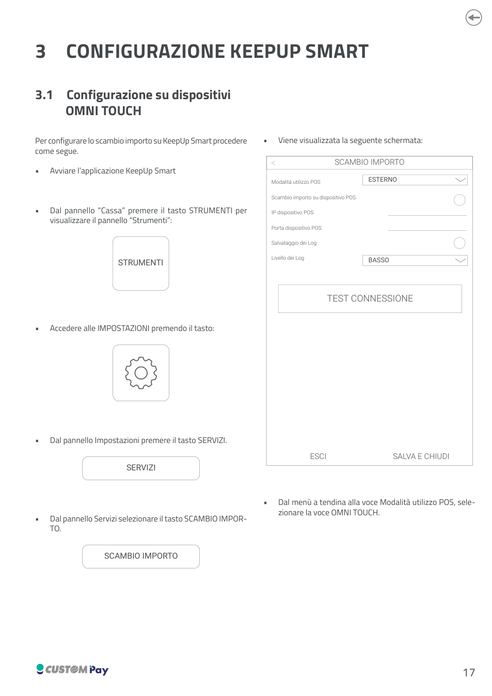
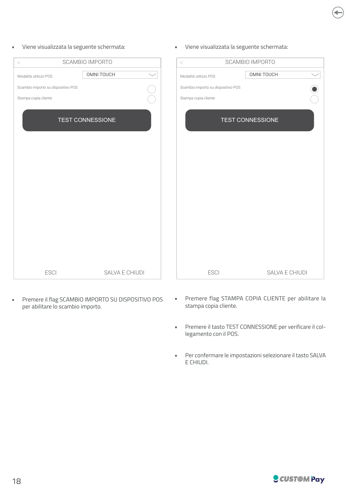
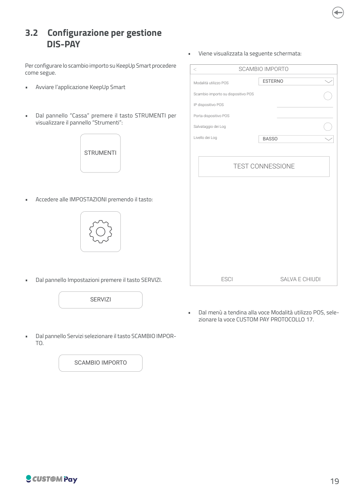
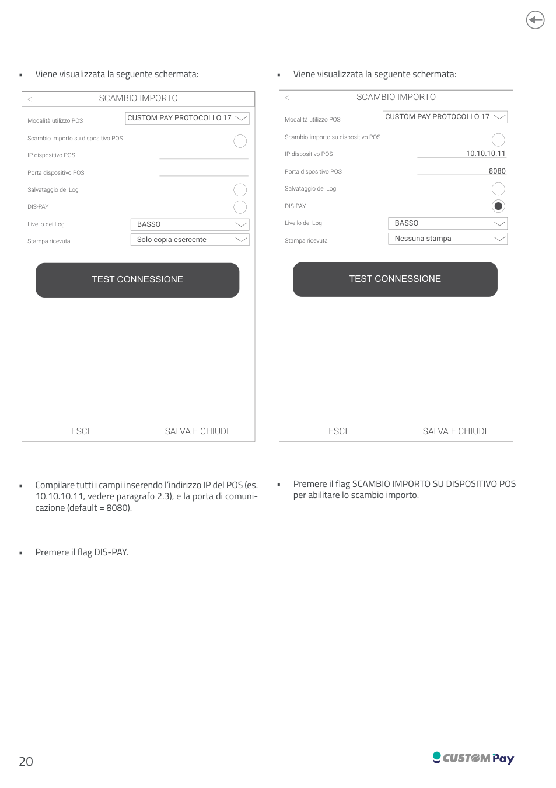
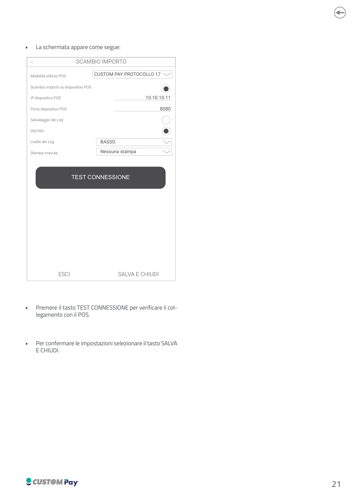

# Configurazione KeepUp Smart

Configurazione dello **scambio importo** tra KeepUp Smart e il dispositivo POS.

## 3.1 Configurazione su dispositivi OMNI TOUCH

1. Avviare l'applicazione **KeepUp Smart**.
2. Dal pannello *Cassa* premere il tasto **STRUMENTI** per visualizzare il pannello *Strumenti*.
3. Accedere alle **IMPOSTAZIONI**.
4. Dal pannello *Impostazioni* premere il tasto **SERVIZI**.
5. Dal pannello *Servizi* selezionare il tasto **SCAMBIO IMPORTO**.
6. Dal menù a tendina alla voce *Modalità utilizzo POS* selezionare la voce **OMNI TOUCH**.
7. Premere il flag **SCAMBIO IMPORTO SU DISPOSITIVO POS** per abilitare lo scambio importo.
8. Premere il flag **STAMPA COPIA CLIENTE** per abilitare la stampa copia cliente.
9. Premere il tasto **TEST CONNESSIONE** per verificare il collegamento con il POS.
10. Per confermare le impostazioni selezionare il tasto **SALVA E CHIUDI**.

## 3.2 Configurazione per gestione DIS-PAY

1. Avviare l'applicazione **KeepUp Smart**.
2. Dal pannello *Cassa* premere il tasto **STRUMENTI**.
3. Accedere alle **IMPOSTAZIONI** e, dal pannello *Impostazioni*, premere il tasto **SERVIZI**.
4. Dal pannello *Servizi* selezionare il tasto **SCAMBIO IMPORTO**.
5. Dal menù a tendina alla voce *Modalità utilizzo POS* selezionare la voce **CUSTOM PAY PROTOCOLLO 17**.
6. Premere il flag **SCAMBIO IMPORTO SU DISPOSITIVO POS** per abilitare lo scambio importo.
7. Compilare tutti i campi inserendo l'indirizzo IP del POS (es. `10.10.10.11`, vedere [paragrafo 2.3 del manuale](assets/resources/0576100M000218_2.00.pdf)) e la porta di comunicazione (default = `8080`).
8. Premere il flag **DIS-PAY**.
9. Premere il tasto **TEST CONNESSIONE** per verificare il collegamento con il POS.
10. Per confermare le impostazioni selezionare il tasto **SALVA E CHIUDI**.

Campi presenti nella schermata *Scambio importo*: Modalità utilizzo POS, Scambio importo su dispositivo POS, IP dispositivo POS, Porta dispositivo POS, Salvataggio dei Log, Livello dei Log (es. `BASSO`), DIS-PAY, Stampa ricevuta (es. `Solo copia esercente` / `Nessuna stampa`).

