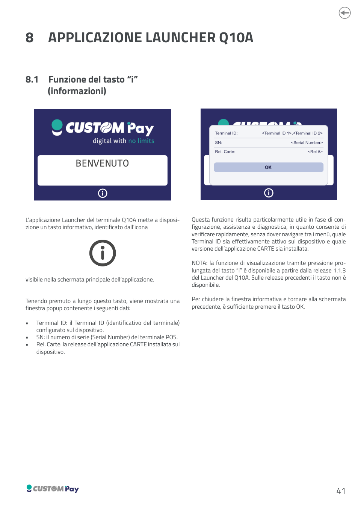

<!-- categoria assegnata per inferenza: verificare -->

# Applicazione Launcher Q10A

## 8.1 Funzione del tasto "i" (informazioni)

L'applicazione Launcher del terminale Q10A mette a disposizione un tasto informativo, identificato dall'icona "i", visibile nella schermata principale dell'applicazione.

Tenendo premuto a lungo questo tasto, viene mostrata una finestra popup contenente i seguenti dati:

| Campo | Descrizione |
|-------|-------------|
| **Terminal ID** | Il Terminal ID (identificativo del terminale) configurato sul dispositivo. |
| **SN** | Il numero di serie (Serial Number) del terminale POS. |
| **Rel. Carte** | La release dell'applicazione CARTE installata sul dispositivo. |

Questa funzione risulta particolarmente utile in fase di configurazione, assistenza e diagnostica, in quanto consente di verificare rapidamente, senza dover navigare tra i menù, quale Terminal ID sia effettivamente attivo sul dispositivo e quale versione dell'applicazione CARTE sia installata.

!!! note "Nota"
    La funzione di visualizzazione tramite pressione prolungata del tasto "i" è disponibile a partire dalla release **1.1.3** del Launcher del Q10A. Sulle release precedenti il tasto non è configurato sul dispositivo.

Per chiudere la finestra informativa e tornare alla schermata precedente, è sufficiente premere il tasto **OK**.

