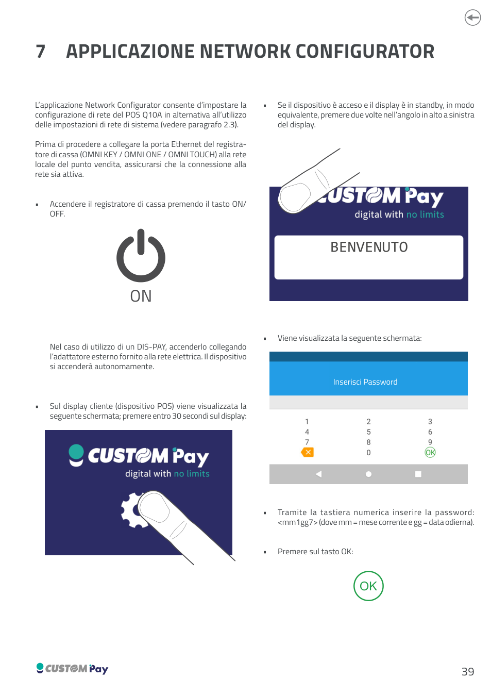
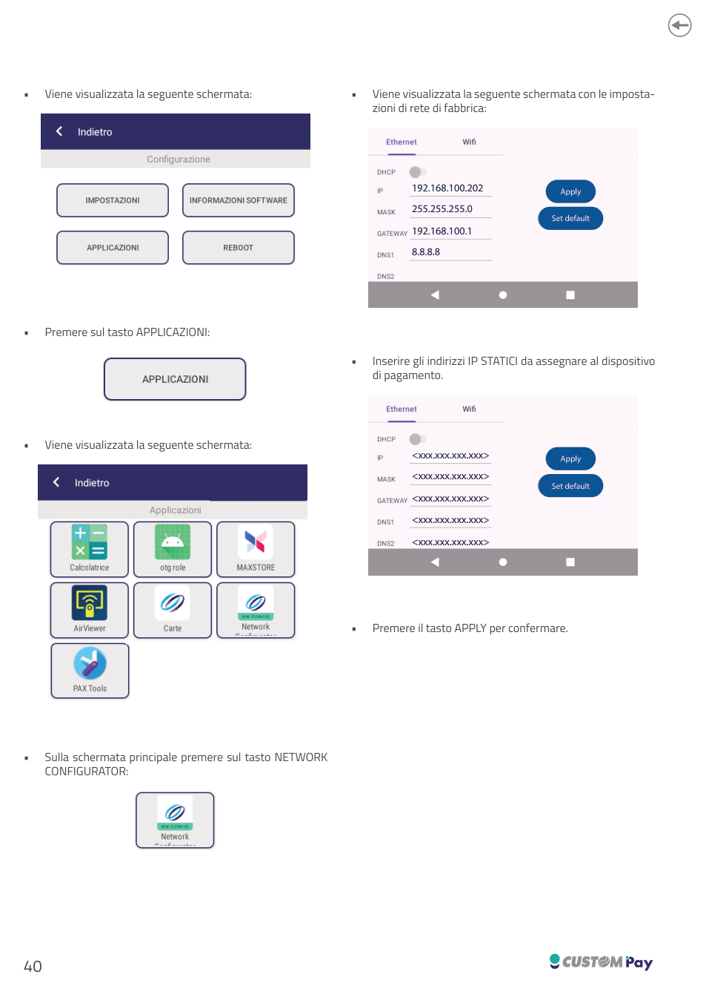

<!-- categoria assegnata per inferenza: verificare -->

# Applicazione Network Configurator

L'applicazione **Network Configurator** consente di impostare la configurazione di rete del POS Q10A in alternativa all'utilizzo delle impostazioni di rete di sistema (vedere [paragrafo 2.3](q10a-comunicazione-pos.md#23-configurazione-su-dispositivo-pos)).

Prima di procedere a collegare la porta Ethernet del registratore di cassa (OMNI KEY / OMNI ONE / OMNI TOUCH) alla rete locale del punto vendita, assicurarsi che la connessione alla rete sia attiva.

1. Accendere il registratore di cassa premendo il tasto **ON/OFF**. Nel caso di utilizzo di un DIS-PAY, accenderlo collegando l'adattatore esterno fornito alla rete elettrica: il dispositivo si accenderà autonomamente.
2. Sul display cliente (dispositivo POS) premere entro **30 secondi** sul display. Se il dispositivo è acceso e il display è in standby, in modo equivalente, premere due volte nell'angolo in alto a sinistra del display.
3. Alla schermata *Inserisci Password* inserire la password `mm1gg7` (dove `mm` = mese corrente e `gg` = data odierna) e premere **OK**.
4. Premere sul tasto **APPLICAZIONI**.
5. Sulla schermata principale premere sul tasto **NETWORK CONFIGURATOR**.
6. Viene visualizzata la schermata con le impostazioni di rete di fabbrica:

    | Parametro | Valore di fabbrica |
    |-----------|--------------------|
    | Indirizzo IP | `192.168.100.202` |
    | Subnet mask | `255.255.255.0` |
    | Gateway | `192.168.100.1` |
    | DNS | `8.8.8.8` |

7. Inserire gli indirizzi IP **STATICI** da assegnare al dispositivo di pagamento.
8. Premere il tasto **APPLY** per confermare (il tasto **Set default** ripristina i valori di fabbrica).

