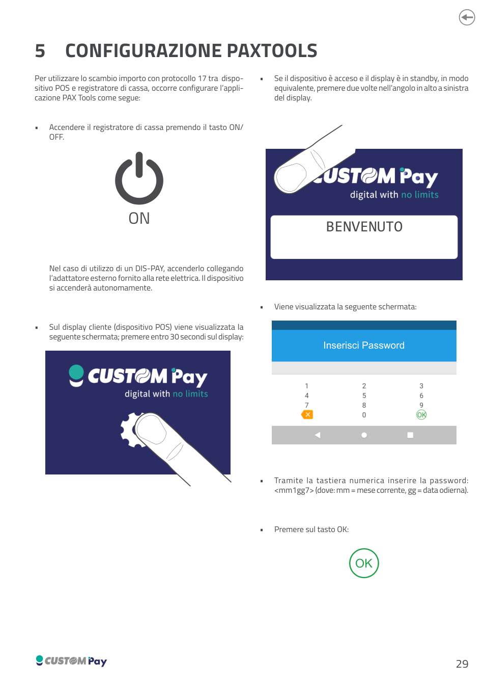
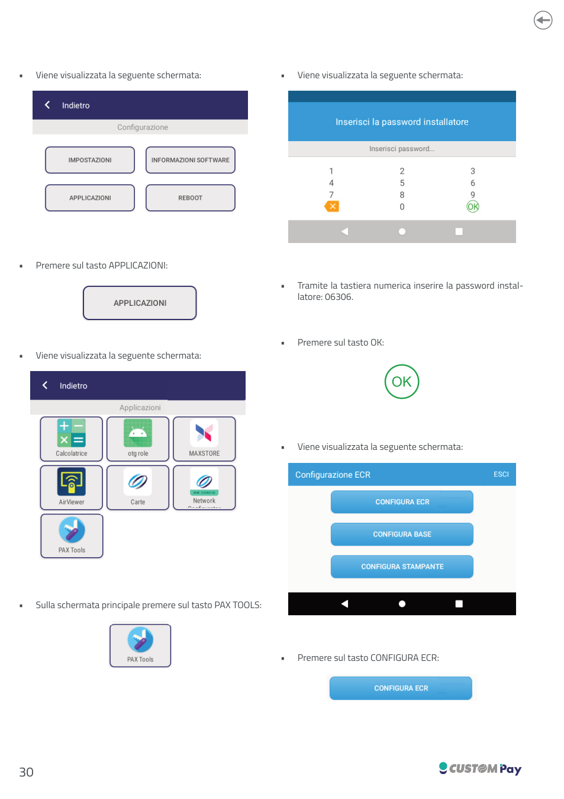
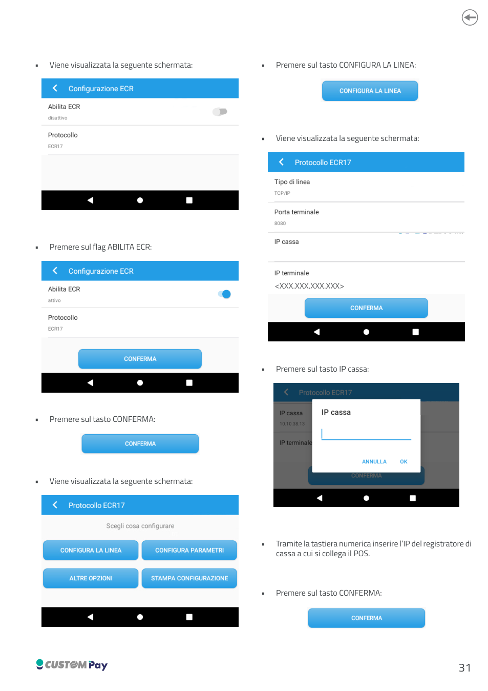
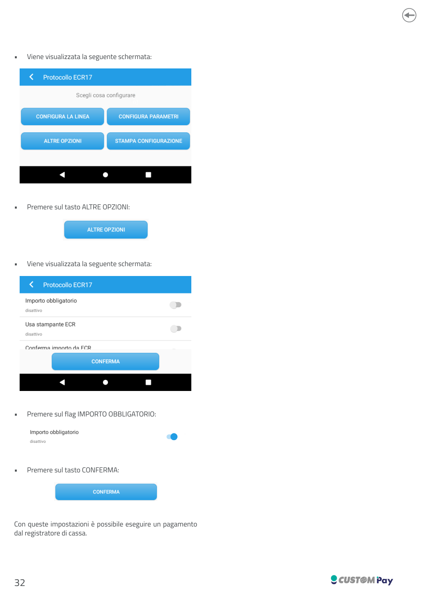

<!-- categoria assegnata per inferenza: verificare -->

# Configurazione PAX Tools

Per utilizzare lo scambio importo con **protocollo 17** tra dispositivo POS e registratore di cassa, occorre configurare l'applicazione **PAX Tools** come segue.

1. Accendere il registratore di cassa premendo il tasto **ON/OFF**. Nel caso di utilizzo di un DIS-PAY, accenderlo collegando l'adattatore esterno fornito alla rete elettrica: il dispositivo si accenderà autonomamente.
2. Sul display cliente (dispositivo POS) premere entro **30 secondi** sul display. Se il dispositivo è acceso e il display è in standby, in modo equivalente, premere due volte nell'angolo in alto a sinistra del display.
3. Alla schermata *Inserisci Password* inserire la password `mm1gg7` (dove `mm` = mese corrente, `gg` = data odierna) e premere **OK**.
4. Premere sul tasto **APPLICAZIONI**.
5. Tramite la tastiera numerica inserire la password installatore: `06306` e premere **OK**.
6. Sulla schermata principale premere sul tasto **PAX TOOLS**.
7. Premere sul tasto **CONFIGURA ECR**.
8. Premere sul flag **ABILITA ECR** e poi sul tasto **CONFERMA**.
9. Premere sul tasto **CONFIGURA LA LINEA**.
10. Premere sul tasto **IP cassa** e, tramite la tastiera numerica, inserire l'IP del registratore di cassa a cui si collega il POS. Premere **CONFERMA**.
11. Premere sul tasto **ALTRE OPZIONI**.
12. Premere sul flag **IMPORTO OBBLIGATORIO** e sul tasto **CONFERMA**.

Con queste impostazioni è possibile eseguire un pagamento dal registratore di cassa.

